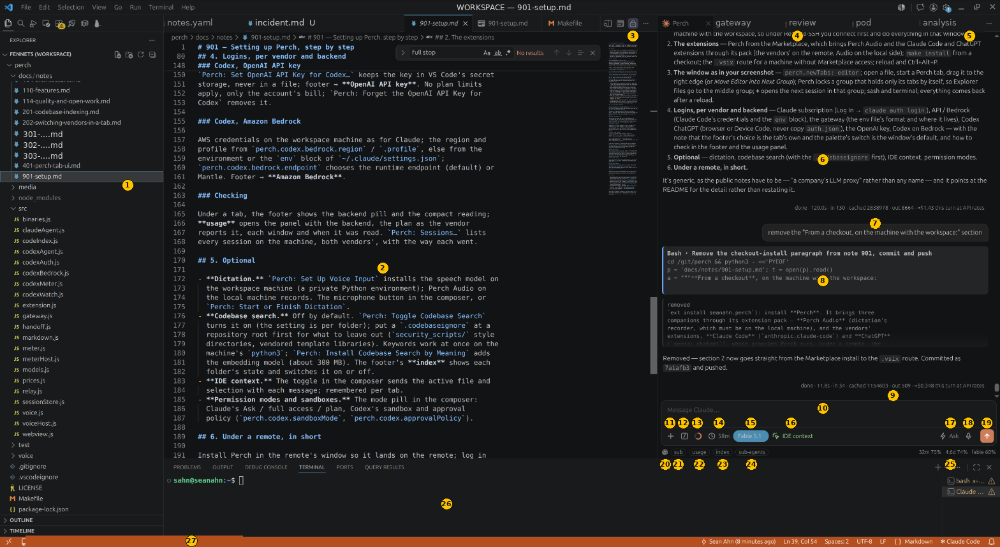

# perch

Claude Code and Codex as tabs in VS Code, in the editor area or the sidebar.
Any number of sessions, with usage and backend switching built in; a tab
can change vendor in the middle of a task.

- **The vendors' own agents, unchanged** — one Claude Code or Codex process per tab, so their prompt caching, compaction and logins; no request of Perch's own ([why](#why-the-vendors-own-agents-so-their-caching)).
- **Tabs where you work** — sessions as editor tabs in a locked group, or in the sidebar; they survive a reload ([where tabs live](#where-tabs-live)).
- **Continue in the other vendor, or another model** — the footer's mark hands the conversation to Codex or Claude as text, a model and effort picked from its menu ([switching](#switching-between-claude-and-codex-in-a-tab)).
- **A backend per tab** — subscription, API / Bedrock or an LLM gateway for Claude; ChatGPT, API key or Bedrock for Codex, each tab's own ([logins](#logins)).
- **Codebase search by meaning** — an index per workspace folder and a `codebase_search` tool for both agents, keywords at once and MiniLM once installed, switched per folder ([codebase search](#codebase-search)).
- **Usage in the footer** — the plan's windows or the cost, a panel with the detail, the session's threads and sub-agents, and each turn's tokens under its answer ([usage](#usage-in-the-footer)).
- **Past sessions, both vendors'** — every session on the machine listed by name, reopened in a tab ([names and past sessions](#names-and-past-sessions)).
- **Permissions as the vendor has them** — Claude's modes and Codex's sandbox and approval policy, per tab, with the prompts answered in the tab ([permissions](#permissions)).
- **Dictation** — speech to text into the composer, the model on the workspace machine, the microphone on yours ([dictation](#dictation)).
- **IDE context** — the active file and selection sent with a message, per tab ([the composer](#the-composer)).

## Why: the vendors' own agents, so their caching

perch runs the **Claude Code CLI** and the **Codex CLI** themselves, one
process per tab, through the vendors' own SDKs. It is a shell around
them, not an agent of its own. That is the whole design, and the reason
is tokens.

### The principle

An agent's token use is a function of prompt caching, and prompt caching
is a function of a byte-identical prompt prefix.

An agent sends the whole conversation to the model at every step of a
turn: system prompt, tool definitions, every message and tool result so
far, then the new step. What keeps that affordable is prompt caching: the
part of a call's prefix that matches a recent call is billed at a tenth of
the input rate (writing the cache costs a quarter more). On a 100k-token
conversation a cached step bills the equivalent of about 10k input
tokens; a cold one about 125k. A cache hit needs the prefix byte-identical
from step to step, and only the program that lays out the prompt can
guarantee that. Claude Code and Codex do. A harness that replaces them
with its own loop and its own prompt gets its own caching, its own
compaction, and API billing instead of your subscription.

The cache itself is the provider's. On the vendors' own APIs it is the
reference. On Amazon Bedrock, which hosts the models rather than proxying
the vendors, both vendors' caching works as their own does (measured for
Codex on Bedrock: every turn after the first read its whole prefix from
the cache), with a lag on the newest options (the hour-long Claude cache
only on some models, no 5m/1h breakdown). Behind a proxy such as an LLM
gateway, whether the markers survive depends on the route; perch shows
what came back, and [note 103](docs/notes/101-purpose-and-rationale.md#n103) says what was measured.

```
PERCH TAB   (the vendor's agent lays out the prompt; perch never touches it)

  turn 1   [system · tools · conversation so far] [new message]  → cache written
  turn 2   [same bytes, unchanged ................] [new message]  → cache hit, 0.1×
  turn 3   [same bytes, unchanged ................] [new message]  → cache hit, 0.1×

A WELL-BUILT HARNESS   (Cursor, measured on the same model and provider)

  turn 1   [system · tools · conversation so far] [new message]  → cache written
  turn 2   [same bytes, unchanged ................] [new message]  → cache hit, 0.1×   (~96 % read back)
  turn 3   [same bytes, unchanged ................] [new message]  → cache hit, 0.1×

A HARNESS THAT RE-RENDERS CONTEXT NEAR THE FRONT   (Continue, as its source lays it out)

  turn 1   [system · editor state A · @context · history] [message]  → cache written
  turn 2   [system · editor state B · @context' · history] [message] → prefix changed: cache miss, 1×
```

So the cache is not what separates a shell from a harness: a harness that
keeps its prefix stable caches as well as the terminal does. What perch
guarantees is narrower: it adds nothing that could bust the vendor's
cache, and it keeps the vendor's billing. The rest of the difference is
the billing path (a subscription applies only to the vendor's own agent;
a harness is API billing by construction) and the agent itself (prompt,
tools, compaction, permissions, tool-call style).

### Where the difference comes from

1. **Prompt assembly.** A harness runs its own agent loop over the
   vendor's model and writes the editor's state into the prompt (the open
   file, the selection, @-mentioned files, the workspace tree). Where that
   lands decides the cache: near the front, where it changes between
   turns, it invalidates everything after it (Continue's context
   providers, as its source lays them out); behind a stable prefix, it
   costs nothing (Cursor, measured). perch never builds a request. The
   prompt an agent sends from a perch tab is the one it would send from a
   terminal, so a tab's cache hits are the terminal's cache hits, and a
   tab costs what a terminal session costs. IDE context in perch is
   appended to the message, at the end, where it changes nothing that
   came before.

2. **Compaction and sub-agents.** A harness that keeps one growing chat
   buffer re-sends every raw tool output on every turn until the window
   is full. The vendors' agents compact on their own judgement, keep
   `CLAUDE.md`, memory, skills, hooks, and MCP servers in play, and
   (Claude Code especially) run searches and other side work in
   sub-agents whose transcripts never enter the main conversation. A
   perch tab inherits all of that unchanged, because it is that agent.

3. **Sessions across reloads.** perch keeps no transcript of its own. A
   tab remembers the agent's session id and, after a window reload or a
   backend switch, resumes that session from the agent's own record
   (`~/.claude/projects/`, `~/.codex/sessions/`), so the prompt prefix is
   the same bytes as before. Within the cache's life (an hour on a
   subscription, five minutes on the API) the earlier turns are still
   cached; beyond it, the next turn re-warms the same prefix once, rather
   than a reconstructed one. The sessions list, names, transcripts, and
   usage gauges are all read from those files and ask nothing of a model.

### Side by side

| | perch | Cursor | Continue |
| --- | --- | --- | --- |
| Agent | the vendor's own: Claude Code, Codex, through their SDKs | Cursor's own loop and middleware, in a forked editor | Continue's own harness, in an extension |
| Prompt | laid out by the vendor's agent; perch adds nothing | Cursor's own, closed source; its prefix stays stable in practice | rebuilt each turn from @-context providers |
| Cache behaviour | the terminal's: a stable prefix, hits turn after turn | the same: ~96 % of each turn read back on turns 2+, measured (Claude Code 95 %) | dynamic context in the prefix breaks the match (from its source; not measured) |
| Cost basis | your existing subscriptions and logins; API / Bedrock when you switch | Cursor's plans and request credits, or an API key | your own API key |
| Compaction, memory, MCP | the vendor's: `CLAUDE.md`, hooks, skills, MCP, sub-agents | Cursor's own indexing and context filters | Continue's client-side providers |
| Cost of a long session | that of a terminal session | about 10 % more than Claude Code on the same model and provider (twice the tool calls, at cached rates), on Cursor's plans rather than your subscription | not measured; its prefix re-rendering says more than a terminal session |

The Cursor figures are one controlled measurement (Claude Code and Cursor
on Opus 5.5 through Bedrock, the same prompts, one price basis,
2026-10-06); an earlier version of this page said "several times a
terminal session" on no source, and a public 5.5× figure turns out to be
one run on mixed models with no cache analysis. What perch can show is
that a tab's cache reads and costs are a terminal's, turn by turn, in its
own footer. The full reasoning, with what has and has not been verified,
is in the design notes, [102](docs/notes/101-purpose-and-rationale.md#n102) and
[103](docs/notes/101-purpose-and-rationale.md#n103).

| Tab kind | Agent | How it runs | Auth |
| --- | --- | --- | --- |
| Claude | Claude Code | `@anthropic-ai/claude-agent-sdk`, streaming input, `canUseTool` for permission prompts | your existing `claude` login |
| Codex | Codex | `@openai/codex-sdk`, one `codex exec` per turn on one thread | your existing `codex` login |

Installed from the marketplace, perch runs the `claude` and `codex`
programs that come with the **Claude Code** and **ChatGPT** extensions,
so those two must be installed as well.

## Where tabs live

`perch.newTabs` decides where a new tab opens.

**`editor`** (the default): each session is a native editor tab, like a
file. The tab row is the first line: there is no container icon row and no
view title above it, because those belong to VS Code's sidebars and an
extension cannot remove them. Tabs carry the vendor's icon, can be dragged,
split, and reordered, and open beside your editor. The **+** in the editor
title bar opens a new one. A working tab's title ends in `…`, and a tab
waiting on a permission prompt while hidden starts with `●`. Closing the
editor tab closes the session.

**`sidebar`**: sessions are tabs inside the Perch view, under the Perch
icon in the activity bar.

Both can be used at once. `Perch: Move Tab to the Editor Area` and
`Perch: Move Tab to the Sidebar` move the active tab; the session, its
agent, and its transcript are untouched. There are `Move All` versions of
both. Tabs saved before this setting existed follow it on the next reload.

An editor group that holds only Perch tabs is locked, the way a terminal's
is, so a file opened from the Explorer goes to the group beside it and not
in among the sessions. When the last Perch tab leaves a group that still
has other tabs, Perch takes the lock off again, so files open there as
anywhere else (VS Code 1.92 or later). `perch.lockGroup` turns both off.

After a window reload VS Code brings the editor tabs back where they were,
and each resumes its session.

## Tabs

Press **+** to open a Claude or a Codex tab: in the editor title bar, or in
the sidebar view's tab bar. Each tab is its own session
with its own agent process, context, mode, draft, and transcript. Open as
many as you like of either kind. When a gateway file exists (see
[Logins](#logins)), a Claude tab can be put on an **LLM gateway**: a
tab whose Claude Code reaches an Anthropic-compatible endpoint of your
own, such as a company's LLM proxy, while the other tabs stay on your
login. Paste an image into the message box to
attach it: up to eight to a message, each scaled down to at most 1568 px
on its long side, the most the API keeps as is. A tab is titled from its first message,
or by you (see below).
While a session works, the foot of its transcript says what it is doing
and for how long. A dot on a tab means it is working; a red dot means it is waiting on a
permission prompt. Middle-click or × closes a tab and stops its agent.

Tab icons are the vendors' own, read at runtime from the Claude Code and
ChatGPT extensions if they are installed. perch ships no logos. It uses
each extension's glyph, tinted as the vendor tints it on its own tabs:
Claude's spark in orange, the ChatGPT blossom in the theme's text colour.
Without a glyph it uses the marketplace image, and without the extension
a letter, C or X.

Answers are drawn as Markdown: headings, lists, tables, code, links. A
link to a file opens it in the editor, at its line if it names one. Each
code block, and each tool call's command, shows a copy button when the
pointer is over it. The
transcript keeps to its end as more arrives, until you scroll away to
read; scroll back to the end and it follows again. A long tool result is
clipped and lets the wheel pass, so scrolling the transcript never
catches on one; click it to open it and scroll inside, click again to
close it.

Agents start lazily: an open tab costs nothing until you send a message.

Tabs survive a window reload. perch saves each tab's session id and the
agent resumes its own saved conversation on the next message. The earlier
transcript is read back from the agent's own record of the session: the
last thousand entries of it, with images as a count and Codex's sealed
reasoning left out.

## Names and past sessions

A tab is named from its first message until you name it yourself: run
`Perch: Rename Active Tab…`, or double-click a tab's name in the sidebar.

`Perch: Sessions…` (the clock icon in the title bar) lists the past
sessions of the workspace folder, Claude's and Codex's together, newest
first. Type to search. Choose one to open a tab on it, or go to the tab
already open on it. The pencil on a row renames that session, open or not.
The bin deletes it, after asking: the agent's own record of the session is
removed from this machine (Claude Code's by the Agent SDK, Codex's by
`codex delete`), and a tab open on it is closed first. A tab you have not
named shows the title its agent's record has, so a tab and its row in the
list say the same name.

perch keeps no list or names of its own. It reads each agent's records,
and writes a name where that agent keeps names: for Claude, in the
session's file under `~/.claude/projects/`, through the Agent SDK, which
is where Claude Code's own `/rename` writes; for Codex, as a line added to
`~/.codex/session_index.jsonl`. So a session named in Claude Code has that
name here, and the reverse. A tab named before its first message has no
record yet; its name is written when its first turn ends.

Tabs do not share history. **Hand off** (`Perch: Hand Off Last Answer to
Another Tab…`, in the `…` menu of the title bar and in the command
palette) pastes the active tab's
last answer into another tab's input box, or into a new tab. That is the
only bridge between tabs, on purpose: shared context would defeat each
agent's caching. One tab can change vendor, though: the next section.

## Switching between Claude and Codex in a tab

A tab can go on with the other vendor: Claude does the work, GPT-6 Astra
reviews it and opens the PR, in the same tab. The left of the footer shows
the destination vendor's mark: Claude under a Codex tab, ChatGPT under a
Claude tab. Click it and choose a model under **Continue on Codex** or
**Continue on Claude**. Clicking the model row uses that model's default
effort; its › menu pins one of the effort levels that model accepts. `Perch:
Continue This Tab in Codex…` and `…in Claude…` also switch from the command
palette and the title bar's `…` menu, restoring that vendor's remembered effort
when it is valid for the model chosen there. The switch is immediate,
and nothing is sent until you send. Only an idle tab switches.

Neither vendor can resume the other's session (the records are each
vendor's own, and the reasoning in them is sealed to the provider that
made it), so the new agent is handed the conversation as text, ahead of
your next message: every message of yours and every reply, in full; each
tool call as one line (`Read src/a.js`, `Bash: make test → failed`),
without its output; no thinking. Tool output is three quarters to nine
tenths of a working session, so this is about a tenth of its tokens. A
task-sized conversation goes whole; a long one sends its latest turns,
and Claude's latest compaction summary, inline, up to about 40K tokens,
and writes the whole of it to a file under `~/.cache/perch/handoff/`,
readable by you alone, which the message names. A divider in the
transcript, with the new vendor's mark, says how much goes and from
where to where (`sent from Claude on your Claude subscription to Codex
on your ChatGPT login`), as a warning when the conversation leaves an
account of your own, Bedrock or a gateway, for a vendor's service; its
**Preview** opens the exact text, until the first message has taken it.

The composer, backend and usage readings, and the editor tab's icon follow
the vendor the tab is on; the footer's handoff mark names the other vendor.
Each vendor keeps its own model, effort, and mode: a vendor
the tab has not used starts on its defaults, one it used before gets back
what it had, and a permission mode is never carried across. Switching
back resumes the vendor's earlier session and hands it only what the
other said since, so Claude's prompt cache is still warm if the detour
was short. After a window reload the tab reads both records back, in the
order it went, dividers included. A tab that has been on both shows the
other vendor's dot beside its mark in the sidebar and the way it went in
its tooltip and in the sessions list (`Claude → Codex → Claude`), where
any of its records opens it; a name you give it goes to every record.
Each switch is logged in the Perch output channel (View › Output ›
Perch). The design and the measurements are in
[note 202](docs/notes/202-switching-vendors-in-a-tab.md).

## Setup, step by step



1. **VS Code 1.92 or later.** Under Remote-SSH or code-server, connect
   first and do the rest in that window: Perch, the agents and the index
   run where the workspace is.
2. **Install Perch** from the Marketplace; Perch Audio (dictation's
   recorder, on the local machine) and the Claude Code and ChatGPT
   extensions (whose programs Perch runs) come with it. Reload, then
   **Ctrl+Alt+P** (Cmd+Alt+P on a Mac).
3. **The layout in the picture.** Open a file, start a Perch tab, drag
   its tab to the right edge of the editor area: a second group. Perch
   locks a group that holds only its tabs, so files from the Explorer go
   to the middle group; **+** in the group's title bar opens the next
   session there. It all comes back after a reload.
4. **Log in** on the first message to a tab of each kind — Claude's
   subscription or Codex's ChatGPT login in the browser — or set the
   backend you want from the footer's menu, which is the tab's own:
   API / Bedrock with Claude Code's credentials, a gateway from an env
   file of yours, Codex on an API key or on Bedrock. [Logins](#logins)
   has each one.

In the picture: the Perch group's tabs and title bar (**+** new tab, the
clock for past sessions); the transcript with a tool card and the turn's
result line; the composer with its tools (**+** files, **/** commands,
the context ring, the cache clock, the model pill, IDE context, the
permission bolt, the microphone, send); and the footer: the other
vendor's mark to continue there, the backend pill, **usage**, **index**,
**sub-agents**, and the plan's reading. Every control is numbered and
named in [note 901](docs/notes/901-setup.md), which is the same guide at
full length.

## Install

From the marketplace: install **Perch**; Perch Audio, the microphone
companion, and the Claude Code and ChatGPT extensions come with it. Log
in to each vendor when Perch asks, on the first message to a tab of that
kind (see Logins below).

From a checkout:

```
make install     # npm install, syntax check, symlink into the extension dirs
```

Step by step, from a bare VS Code to the working layout and a login for
each vendor and backend: [note 901](docs/notes/901-setup.md).

Reload the window, then press **Ctrl+Alt+P** (Cmd+Alt+P on a Mac):
`Perch: Open` brings back the tab you last used, or, with none open, the
sessions list, which starts a new tab of either kind at the top. The same
is behind the Perch icon in the activity bar and `Perch: New Tab…` in the
command palette.

## Logins

Both agents run on the logins already on the machine with the workspace:
Claude Code's (`~/.claude`) and Codex's (`~/.codex/auth.json`). Nothing
is copied from elsewhere, so a fresh remote has neither.

- **Claude, on a subscription**: the first message to a Claude tab on a
  machine with no login is held back, the text put back in the box, and
  **Log In** offered: `claude auth login` in a terminal, run with the
  `claude` the tabs run (`perch.claude.executable` when it is set), and
  off Bedrock even when `~/.claude/settings.json` sets
  `CLAUDE_CODE_USE_BEDROCK=1` (the Claude Code panel only when no
  program is found). Perch notices when a new login lands and says so;
  send the message again. One login runs at a time: pressed again while
  one waits, Log In brings its terminal back, and closing that terminal
  ends the wait. On Windows the terminal runs `claude` itself, with no
  shell in between, and closes when it ends. The footer's "log in" does
  the same at any time.
- **Claude, on API / Bedrock**: the `API` switch in the footer moves
  Claude to those credentials. They are Claude Code's, not Perch's: AWS
  credentials or a profile on the workspace machine (`~/.aws`, or
  `AWS_*` variables), or `ANTHROPIC_API_KEY`; the region and model go in
  the `env` block of `~/.claude/settings.json` (`AWS_REGION`,
  `ANTHROPIC_MODEL`, and the small/fast model if you use one). With none
  of that in place the first message is held back and the offer opens
  that file, or switches back to the subscription.
- **LLM gateway**: a Claude tab can be put on a gateway, an
  Anthropic-compatible endpoint reached with `ANTHROPIC_BASE_URL` and a
  token, as a company's LLM proxy is. The variables live in a file of
  yours, `~/.config/gateway-claude/env` by default
  (`perch.claude.gatewayEnv`), written as a shell reads it: `export
  ANTHROPIC_BASE_URL=…`, `export ANTHROPIC_AUTH_TOKEN=…` (or
  `ANTHROPIC_API_KEY`), and any model names (`ANTHROPIC_MODEL`,
  `ANTHROPIC_DEFAULT_OPUS_MODEL`, …). The same file can drive a terminal
  launcher. A tab on the gateway runs its Claude Code process with those
  variables added to its environment, and that is all: nothing is
  written to `~/.claude/settings.json`, the token is never in a file of
  Perch's, and the session, its record, your `CLAUDE.md`, memory, and MCP
  servers are the same as any other tab's. Put a tab on it from the
  footer's backend menu under any Claude tab, where the entry reads
  **LLM gateway** (or with `Perch: New Claude Tab on the Gateway`);
  once chosen, new Claude tabs start there until a tab is put back on the
  subscription or API / Bedrock. The template also sets
  `ENABLE_PROMPT_CACHING_1H=1`: on a token Claude Code would keep the
  prompt cache for five minutes, after which a turn re-sends the whole
  conversation at the cache-write rate; the hour costs more per write and
  less by the first pause over five minutes. Remove the line if the gateway
  rejects the request. The first message to a tab whose file is
  missing or incomplete is held back, and the offer opens the file (made
  from a template, readable by you alone) or takes the tab off the
  gateway; the two choices stay as buttons under the note. The window's own backend does not matter: with Claude set to
  API / Bedrock in `~/.claude/settings.json`, a tab on the gateway still
  goes to the gateway, because Perch gives its process the gateway's
  variables (all but the token) as settings of its own, which Claude Code
  applies over the user's.
  A tab on the gateway runs its process through a small relay of
  Perch's on the loopback interface, which forwards each request to the
  gateway unchanged and reads the header in which a LiteLLM gateway
  names the model that answered (`x-litellm-model-name`); a routed name
  such as `auto` may send each request anywhere. The line under
  each answer then says what answered the turn's requests, `via
  gpt-6-luna ×3, grok-4.6`, and what the gateway charged for them,
  `$0.0021 this turn`, its own figure (`x-litellm-response-cost`,
  summed) in place of Claude Code's estimate at Anthropic list prices,
  which does not apply to a gateway's names; the tooltip has the
  session's total by the same reckoning. A streamed response carries no price from the gateway, so a
  turn is priced at list rates for the model that answered each request
  (LiteLLM's public price table, fetched weekly) and shown with `≈`; the
  tooltip says so, and gives the token's running total as the gateway
  counts it. The model button's tooltip
  names the last model. The agent is still Claude Code; the model is
  whatever the gateway chose.
- **Codex**: the first message to a Codex tab on a machine with no login is
  held back, the text put back in the box, and the login offered two ways.
  **Log In** runs `codex login` on the workspace machine and opens
  ChatGPT's sign-in page in your browser; the page returns to a local port,
  which VS Code forwards to the workspace machine when it is remote, so
  this works for anyone with a browser. **Device Code** runs
  `codex login --device-auth` in a terminal instead: a link and a one-time
  code, for a machine with no forwarding, which ChatGPT has to allow first
  (Settings → Security and login → App security → "Enable device code
  sign-in"). On Windows that terminal runs `codex` itself, with no shell
  in between, and closes when it ends; closing it ends the wait. Either
  way Perch notices when the login lands and says so; send the message
  again.
  A login can also end later: ChatGPT ends the session on a logout, a
  password change, a revoked session, or when the same login is refreshed
  on another machine. **Give each machine its own login: never copy
  `~/.codex/auth.json` from one machine to another**, since the two copies
  share one session and the first to refresh it ends the other's. When
  Codex reports its login refused (`token_revoked`,
  `refresh_token_invalidated`, "Your session has ended"), the tab puts the
  message, and any queued behind it, back in the box, says why under the
  error with **Log In** and **Device Code**, and holds further messages on
  that machine until there is a new login (or until another Codex there
  refreshes the file), across window reloads. The login waits for a new
  `auth.json`, so signing in again works though the old file is still
  there. One login runs at a time (it listens on a fixed port): pressed
  again while one waits, from the note, the notification, or another tab,
  a button opens the same sign-in page again, or brings back the Device
  Code terminal; once the login lands, every
  login note in every Codex tab says so in place of its buttons.
  On the gateway the model menu is the file's names, not Claude Code's
  catalog: the default is `ANTHROPIC_MODEL`, and opus, sonnet and haiku
  are what `ANTHROPIC_DEFAULT_*_MODEL` map them to, which is what the
  gateway receives. A tab moved onto the gateway with another model
  chosen starts from the file's default. The choice sticks: once a tab
  is put on the gateway, new Claude tabs start there, until a tab is put
  back on the subscription or API / Bedrock.

## Permissions

Claude: the SDK calls back on every tool use and perch shows Allow /
Always / Deny. The request reads as what it is: for an edit, the file
and the change as a diff, removed lines then added; for a new file, the
file and what goes in it; for a command, the command and what it is for.
The default mode for new tabs is a setting
(`perch.claude.permissionMode`) and each tab can switch live.

Codex: the SDK runs `codex exec`, which is non-interactive. Approvals
resolve by policy (`perch.codex.approvalPolicy`) and the sandbox
(`perch.codex.sandboxMode`). There is no per-command prompt.

Codex's sandbox on Linux is bubblewrap, which needs unprivileged user
namespaces; a container that forbids them (a JupyterHub pod, say) fails
every command with `bwrap: No permissions to create a new namespace`, and
Codex has no other sandbox there. When that happens Perch asks whether to
run Codex without a sandbox, for that tab or for every tab on that
machine from then on; the choice is remembered by hostname, and such tabs
say so when they open.

## The composer

Each kind of tab takes its own vendor's look, so a Claude tab feels like
Claude Code and a Codex tab like Codex.

**Claude tab**, left to right:

| Tool | What it does |
| --- | --- |
| **+** | Pick files and mention them by path, as `@src/a.js`. |
| **/** | Slash commands, read from Claude Code. Typing `/` opens the same list, filtered as you type; Enter completes. |
| ring | How full the context window is. Amber at 80%, red at 95%. |
| clock | Minutes until the prompt cache goes cold. A message sent before then is billed at the cached rate. One hour on a subscription, five minutes on API or Bedrock, unless you set `promptCacheTtl`. |
| pill | Model and effort. Opens a menu for both. |
| bolt | Permission mode: Ask, Edits, Plan, Auto, Bypass. |
| square | Send. While Claude is working it becomes Stop. |

**Codex tab**: **+**, then the sandbox behind a shield (Read only, Workspace,
Full access, the last in amber), the model with its effort, **IDE context**,
and a round send button. Codex runs on this machine through the SDK;
Codex Cloud tasks are not offered (the SDK has no way to run a thread
there), so there is no "Work locally" chooser as in the Codex extension.

**ChatGPT apps and plugins in a Codex tab** (Gmail, SharePoint, and the
rest of ChatGPT's plugin directory) are Codex's own: perch runs `codex
exec`, which takes the plugins installed in the ChatGPT account it is
logged in with and the apps connected there. Two things happen outside
perch, once, on the machine where the tab's Codex runs (over Remote-SSH,
the remote host, as the remote user):

1. Install the plugin with the same `codex` perch runs there (the one in
   the ChatGPT extension when perch's own is not packaged):
   `codex plugin list`, then `codex plugin add sharepoint@openai-curated-remote`.
   It is recorded in the ChatGPT account and cached under `~/.codex/plugins/`.
2. Connect the app on chatgpt.com, in your browser, signed in to the same
   ChatGPT account and workspace as that machine's `~/.codex/auth.json`.
   The first call to an app that is not connected shows a note with a
   **Connect on ChatGPT** button: the link Codex gives, which its own reply
   does not show. Microsoft's sign-in happens there; nothing of it passes
   through perch or the host.

To keep an app read-only, block its tools that say they write, in
`~/.codex/config.toml` on that machine:
`[apps.<connector_id>]` `destructive_enabled = false` (SharePoint's id is
`connector_1e4f6a44acf14e3ca1d96672f8c945bc`).

When a Codex turn starts **sub-agents**, each shows as a line in the
transcript when it starts, reports, takes a follow-up task, and finishes
(`⤷ desktop_audio_transport started`), and the line at the foot says how
many are working (`sub-agents: 2 working, 1 done`, each by name in its
tooltip). Click that count for a table of them: each one's model and
reasoning effort, turns, and tokens, read from the sub-agent's own thread
file as it grows; a sub-agent's end line says the same, as does a past
turn's when a session is read back, and the line that ends the turn opens
to the same table. What they report is encrypted, so only that they
reported can be shown. A **question Codex asks without waiting** shows as a card that
says so: the turn carries on, and your answers go to it as your next
message, queued behind the turn if it is still working. The SDK streams
neither, so perch reads them from the thread's own record in
`~/.codex/sessions/` as the turn runs.

For the **whole session's usage**, click **sub-agents** in the footer of
a tab. It opens a table with one row per thread: the main thread, each
sub-agent it started, and the totals. Codex's threads are read from their
rollout files, Claude's from the session's file and the sub-agent files
Claude Code keeps beside it. Each row has the model and effort,
turns, input (the cached part shown too), output, and what those tokens
would cost at OpenAI's list prices (LiteLLM's public price table), with
each one's share of the session. Click a column to sort the sub-agents by
it. The table is read from the session's files when you open it, and again
at the end of each turn while it is open. On a ChatGPT plan nothing is
billed per token, so the cost says where the work went, not what you pay.

A **web search** shows what it searched for, or the page it opened or
looked in, once it completes, with the pages it found under it. Codex says
what a search was only when it ends, so until then the card reads
`web search …` and the foot of the transcript *Searching the web*.

**IDE context**, on both kinds of tab, is on by default for new tabs
(`perch.ideContext`) and remembered per tab. The toggle is green when on
and grey when off. When on, each message carries
the active file and, if there is one, the selection with its line numbers,
as the vendors' own panels do. The transcript shows your message with a
small tag, the file's name and the lines if any, not the attachment itself. The context is read when you
write the message, so a queued message keeps the file that was open then.
A Perch tab in the editor area takes the focus while you type, so the
file attached is the one last focused, as long as it is still open on
screen; the tag on your message says which.

**Earlier messages.** The arrow keys walk the tab's earlier messages,
as a shell does: Up from the first line of the box goes back, Down from
the last line comes forward, and past the newest the draft you were
writing returns.

**Queueing.** Enter always sends. While the agent is working, the message
is queued behind the current turn and marked so. Claude Code queues it
itself; Codex takes one turn at a time, so perch holds the queue and feeds
it as each turn ends. The × on a queued message takes it back until its
turn starts (its words stay in the box's history: press the up arrow to
get them back); once a turn has taken it up, the tab says it was too
late. Stop ends the turn and drops what is queued.

Not included: Codex's microphone. A webview cannot open the microphone;
Codex does it with a companion extension that records natively. perch could
do the same, but dictation also needs a speech-to-text service, which is a
choice for you to make.

## Model and effort

The model and effort menu opens from the pill (Claude) or the model name
(Codex).

The lists come from the agents themselves, so they match your account:

| | Models from | Efforts from | Default labels |
| --- | --- | --- | --- |
| Claude | the Claude Code CLI, asked at startup without sending a message | each model's supported levels | `default · Sonnet 4.6` names the model Claude Code starts on, then the one the session reports |
| Codex | `~/.codex/models_cache.json` | each model's supported levels | `default · GPT-5.6-Sol` and `default · ultra` come from `~/.codex/config.toml` |

The effort list follows the selected model. A model with no effort
control says so in the menu, and an effort the new model does not accept
resets to default. `Perch: Refresh Model Lists` re-reads both.

Claude: model, effort, and mode all change live, from the next message.
Hover the model selector to see the model actually running.

On default, Claude Code starts on `ANTHROPIC_MODEL` if it is set, else
the `model` in its settings, else its own default (Opus 5.5 today), and
the pill names that model. Once the session runs, the pill and the
effort list follow the model the session reports. Choosing default in a
running session gives Claude Code's own default, not the model the
session started on; the option's tooltip says which is which.

Claude Code itself can move a session to another model. When a model's
safeguards refuse a response, it retries the response on a fallback
model and keeps the session there: Opus 5.5 to Opus 4.8, say. The pill
then names the model running, in the warning colour, with the reason in
its tooltip, and Claude Code's notice is in the transcript, also when
the session is opened again later. A turn answered by a model other
than the one chosen ends its line with `answered by Opus 4.8`: each
response names the model that gave it. A new session starts on the
chosen model again.

Codex: model, effort, and sandbox change from the next message too. Codex
runs each turn as a process of its own, so perch takes the thread up again
with the new choice. Codex itself notes in the transcript when a thread
recorded with one model is carried on with another. The sandbox menu also
shows the approval policy.

A model chosen by its id rather than from the list, Bedrock's
`us.anthropic.claude-fable-5-1` or a `[1m]` form, is named as the
catalog names the same model (`Fable 5.1 (1M)`), offers that model's
efforts, and is sent under the name the tab's backend knows it by.

Defaults for new tabs: `perch.claude.model`, `perch.claude.effort`,
`perch.claude.permissionMode`, `perch.codex.model`,
`perch.codex.reasoningEffort`, `perch.codex.sandboxMode`.

## Codebase search

Claude and Codex tabs get one more tool, `codebase_search`: a question
in plain words finds the files that answer it, even when they share no
names with it. It is Cursor's codebase index, done the Perch way: a tool
the agent calls, so results come after the cached prompt, never into it.
The design and the measurements are in
[note 201](docs/notes/201-codebase-indexing.md).

- **Off by default.** `perch.codebaseIndex.enabled` turns it on, for
  every workspace or for one; `Perch: Toggle Codebase Search` flips it.
  A change reaches each tab from its next message: a Claude tab
  restarts, after its turn if one is running (its tool list is part of
  its cached prompt, so the cache starts over once); a Codex tab's next
  turn is a process of its own anyway.
- **Keywords at once, meaning once installed.** Keyword search (BM25)
  needs only the machine's `python3`, 3.8 or newer with SQLite FTS5.
  Search by meaning needs an embedding model, MiniLM, in a private
  environment of about 300 MB under `~/.local/share/perch/codeindex`:
  Perch offers it once, as the first tab starts, and `Perch: Install
  Codebase Search by Meaning` installs it later. A tab's search server
  moves onto it by itself, without a restart.
- **Every folder of the workspace,** in the Explorer's order, each with
  an index of its own; a folder's own `.vscode/settings.json` can turn it
  off or on for that folder alone, and with several folders the results
  carry full paths. The tool takes a `folder` to search one of them by
  name, and returns 8 hits instead of 5 when there are more than two.
- **The index stays on the machine with the code.** It is kept in
  `~/.cache/codebase-index/`, outside the repository, private to you, and
  brought up to date from the files that changed. Under Remote-SSH it is
  built on the remote, where the agents run; nothing leaves that machine
  but the one-time download. The first index of a repository of about
  1,500 files takes seconds by keywords and a few minutes by meaning, on
  a CPU, in the background: until then the tool says how far it has got
  and the agent goes on with grep.
- **What is left out:** whatever git ignores, lockfiles, binaries, files
  over 256 KB, secrets by name, every hidden file and directory of a
  folder that is no repository (a home directory opened as the workspace:
  the repositories inside it are each taken by git's own view), and the
  patterns in a `.codebaseignore` at the repository root (`dir/` for a directory, else a path pattern such as `*.min.js`).
  A `.codebaseignore` that is just `*` turns search off for that
  repository; the tool stays, and says so.
- **Codex may need telling.** Claude reaches for the tool by itself;
  Codex, in testing, kept to `rg`. A line in the repository's `AGENTS.md`
  ("use `codebase_search` when you do not know the names involved")
  changes that.
- **In a terminal too.** The server is Perch's `codeindex/server.py`;
  `claude mcp add -s user codebase -- python3 <it>` or `codex mcp add
  codebase -- python3 <it>` gives the CLIs the same tool outside Perch.
- `perch.codebaseIndex.python` names the Python to run it on, if not
  `python3`.
- **Its switches and its state, in the footer.** Under a tab, the
  **index** button next to **sub-agents** opens a table of the
  workspace's folders: each with its setting, a switch that writes the
  folder's own `.vscode/settings.json`, and its index — files and
  sections indexed, how many sections have vectors, whether it is
  searched by keywords or by meaning, and whether it is being built. A
  switch in the header turns search on or off for the workspace, as the
  command does. The table is read from the indexes' files every few
  seconds while the panel is open, so a first build shows its counts
  growing; it only reads, and never starts a build.

Whether it pays depends on the repository, which is why it is off until
you turn it on. On a well-documented one of 1,500 files, Claude and Codex
found nine answers in ten without it, and the tool cost Claude a step or
two a question; it helps where the names in the code are not what you
would ask for.

## Usage, in the footer

The footer follows the active tab.

**Under a Codex tab**: a **backend menu** (`ChatGPT`, `API` or
`Bedrock`), the **usage** button, and the plan's usage: percent remaining
and time to reset for the five-hour window and the week. The menu moves
Codex between your ChatGPT login, an OpenAI API key and Amazon Bedrock.
Choosing the key the first time asks for it and keeps it in VS Code's
secret storage, never in a file of perch's; Codex gets it in its
environment, per turn, so open tabs move on their next message with
nothing restarted. Bedrock uses Codex's own Bedrock provider with the AWS
credentials on the machine (a profile, `AWS_*` variables, or
`AWS_BEARER_TOKEN_BEDROCK`); the region and profile come from
`perch.codex.bedrock.region` and `.profile`, else from the environment or
the env block of `~/.claude/settings.json`, where a machine set up for
Claude on Bedrock has them. By default Codex goes through the Bedrock
runtime's OpenAI-compatible endpoint in your region, with models named
`us.openai.<model>` and the same `bedrock:*` permissions Claude uses;
`perch.codex.bedrock.endpoint: mantle` uses Bedrock Mantle instead
(us-east-1 by default, `openai.<model>`, its own IAM action). The ChatGPT
connector apps are off on Bedrock, where they cannot work; left on, their
schemas cost about 25 K tokens a request. The model menu stays Codex's;
each name is sent in Bedrock's form. On the key or on Bedrock there is no plan and no limit to show,
only per-token billing on that account.
`Perch: Set OpenAI API Key for Codex…` and `Perch: Forget the OpenAI API
Key for Codex` manage the key. Codex records these in its session files after every turn, so
perch reads them from `~/.codex/sessions/` and makes no request. The
figure is as of the last Codex turn on this machine, from any Codex client,
and the tooltip says when that was. A window whose reset time has passed
is shown as full again. perch re-reads after each Codex turn it runs.

**Under a Claude tab**:

- a **backend button**, `sub`, `API`, or `gw`. Click it for a menu of
  three, each **this tab's own**: **subscription (login)**, **API /
  Bedrock**, and **LLM gateway** (see [Logins](#logins)). The choice goes
  to the tab's next process as settings of its own, which Claude Code
  applies over `~/.claude/settings.json`, so two tabs can run on
  different backends side by side and nothing is written to the file.
  The window's default — what a tab that has not chosen runs on, and what
  `claude` in a terminal gets — is `env.CLAUDE_CODE_USE_BEDROCK` in that
  file, switched by `Perch: Toggle Claude Backend`; tabs that follow it
  come along with the switch, tabs with a choice of their own stay put.
  Either way a tab's process ends (after its current turn, if one is
  running) and the next message resumes the same conversation on the new
  backend, as after a window reload; the prompt cache starts over, being
  the backend's. A tab on a backend the window is not on shows `—` for
  the usage, which is the window's reading, not the tab's. Under a tab on the gateway the
  button reads `gw`, with a warning while its file is missing or
  incomplete, and the gauge shows nothing: the gateway's usage is not
  reported here, and the line under each answer shows its tokens and
  which models answered.
- a **usage gauge**. On a subscription: percent remaining and time to
  reset for the 5-hour session, the week, and any model-scoped weekly
  limit, amber or red when one runs low. On API / Bedrock: the model in
  use and today's tokens and estimated cost, from the local transcripts.
  Hover for detail.
- the **usage** button, beside **index** and **sub-agents**; it and the
  gauge open the same panel. Under either vendor the panel has the same
  shape: the backend; the plan as the vendor reports it (ChatGPT names
  yours, `Pro`, with its credits; Anthropic's usage endpoint names none,
  so none is shown); each window with its percent remaining, a word for
  a low one beside its colour, and its reset time; when the reading was
  made (a Codex reading is as of the last Codex turn on this machine);
  **refresh**, or **log in** when that is what is missing; a link to the
  account's usage page; and **session breakdown**, which opens the
  sub-agents table. On the API key or on Bedrock it says there are no
  plan limits, only the account's bill, and under Claude's API / Bedrock
  it shows the cost estimate, marked as one; through the gateway it says
  nothing is reported. A stale reading is kept and marked stale. One of
  the three panels is open at a time; Escape closes it.

This is [AI Meter](https://github.com/seanahn/ai-meter) merged into perch.
The gauge lives in the footer of each tab; perch puts nothing in the
status bar. AI Meter can stay installed for a gauge that is visible
whatever editor is open.

Privacy is unchanged from AI Meter. Subscription mode reads the OAuth token
Claude Code stores and sends it only to `api.anthropic.com/api/oauth/usage`.
Cost mode makes no network requests. Costs are estimates at Anthropic list
prices; Bedrock or partner billing may differ.

Switching models pins: a Bedrock model id saved in the settings file is
set aside when you switch to subscription, which cannot use it, and put
back when you switch to API. A settings file that is not valid JSON is
never overwritten; perch tells you instead.

The usage endpoint rate-limits. When it does, perch keeps the last reading,
marks it stale in the tooltip, and leaves the endpoint alone for at least a
minute, doubling up to half an hour. Clicking refresh during that pause
makes no request.

Settings: `perch.meter.mode`, `pollMinutes`, `display`, `showModelWeekly`,
`warnBelow`, `errorBelow`.

## Dictation

The microphone in the composer dictates into the message box. Click to
start, click again to finish, Escape to discard.

Speech-to-text is Whisper, running locally. Nothing you say leaves your
machines. The first use asks to set it up: about 4 GB, into a private
environment under `~/.local/share/perch/voice`. It needs a `python3`;
one without `venv`/`pip` support (Debian and Ubuntu before
`python3-venv` is installed) is fine, pip is fetched from
`bootstrap.pypa.io` into the private environment.

Recording is done by a second extension, **Perch Audio**, which must be
installed on the computer you sit at, because that is where the
microphone is:

| You work | Install Perch Audio on | Whisper runs on |
| --- | --- | --- |
| Directly on this machine | this machine (`make install-audio`) | this machine |
| From a computer with an NVIDIA GPU, over Remote-SSH | that computer (it comes with Perch) | that computer, in Perch Audio; only the text goes to the remote |
| From a laptop with no GPU, over Remote-SSH | the laptop | the remote machine; the audio goes there |

`perch.voice.runOn` overrides the choice (`local` or `remote`). Perch Audio
carries the same engine as Perch, so a GPU under your desk is used even
when the workspace is a CPU-only container far away.

If no microphone is connected, the button says so. `Perch Audio: Choose
Microphone` picks among several.

Bluetooth ear buds and headsets work too. In their music profile (A2DP)
they have no microphone at all, so Perch Audio lists them from the sound
server's card list, switches them to the headset profile for the
recording (mSBC, 16 kHz, when the device offers it) and back to music
when it ends. Music through them pauses for the length of the dictation.
A plugged-in microphone is preferred when there is one; pick the headset
by name to dictate into it regardless.

The model follows the machine: `large-v3-turbo` on an NVIDIA GPU, `small`
on a CPU (`perch.voice.model` names one instead). On a CPU the turbo
model's encoder alone takes seconds; `small` returns a sentence in about
one, at a little less accuracy. Setting `perch.voice.language` (`en`,
`ko`, …) halves the wait again, because detecting the language is a
second pass over the audio.

Verified end to end on 2026-09-30, dictating messages into a tab, on
this machine (GPU) and over Remote-SSH to a CPU-only container.

A web address in an error or a note is a link. The other vendor's mark at
the left of the footer is only for continuing the tab on that vendor (see
[Switching](#switching-between-claude-and-codex-in-a-tab)); the plan badge
under a Codex tab (Plus, Pro) opens your ChatGPT usage page, where limits
and credits are managed.

## Cost

Both agents run on your subscriptions through their normal logins. This
is for personal use on your own machine. Shipping it to other people
would require API-key billing under both vendors' terms.

## Packaging and publishing

`make package` builds `perch-<version>.vsix`, about 8 MB. It carries the
two SDKs but not the `claude` and `codex` programs they run: those are
hundreds of megabytes, and built for one platform. A packaged Perch runs
the programs inside the Claude Code and ChatGPT extensions, so those two
extensions must be installed where Perch is: they are in Perch's
`extensionPack`, so the marketplace installs them with it, on the
workspace side, and either can be removed if only one vendor is wanted.
`perch.claude.executable` and `perch.codex.executable` name a program of
your own instead. In this checkout, installed from npm, the SDKs bring
their own programs and those are used.

Install the file on another machine with
`code --install-extension perch-<version>.vsix`.

To publish to the marketplace, as AI Meter is: create the publisher named
in `package.json`, run `make login` once (or keep the token in
`~/.ssh/azure-dev.pat`, or put `VSCE_PAT=<token>` in `.env`), then `make publish`. `make publish-patch` and `make publish-minor`
bump the version, commit, and tag first.

Perch Audio, the microphone companion, is an extension of its own,
because it has to run on the computer you sit at while Perch runs with the
workspace. Perch names it in its `extensionPack`, so installing Perch from
the marketplace installs Perch Audio too, each on the machine it belongs
on. `make publish` publishes Perch Audio first if its version is new.
Installed from a `.vsix` file, Perch does not fetch it: build it with
`make package-audio` and install that file as well.

## Layout

- `src/extension.js` — the view, sessions, tab state, persistence, commands
- `src/claudeAgent.js` — Claude Agent SDK session, no VS Code dependency
- `src/gateway.js` — the gateway file: reading it, what makes it usable, the environment a tab gets; no VS Code dependency
- `src/relay.js` — the loopback relay a gateway tab's process goes through, which reads which model answered; no VS Code dependency
- `src/codexAgent.js` — Codex SDK thread, no VS Code dependency
- `src/models.js` — model catalogs read from the agents, no VS Code dependency
- `src/meter.js` — Claude usage, cost, and the backend switch, no VS Code dependency
- `src/binaries.js` — where the agents' programs are: the SDK's own, or the vendor extension's
- `src/codexMeter.js` — ChatGPT plan usage, read from Codex's session files
- `src/markdown.js` — an answer's Markdown, drawn as DOM nodes; written into the page as source
- `src/sessionStore.js` — past sessions and their names, read from and written to the agents' own records
- `src/handoff.js` — a tab's conversation as text the other vendor's agent can read, for a switch; no VS Code dependency
- `src/meterHost.js` — polling, the backend switch, login
- `src/voice.js`, `src/voiceHost.js` — the speech-to-text engine, and dictation
- `voice/server.py` — Whisper behind JSON lines
- `src/codeIndex.js` — codebase search's Perch side: the Python it runs on, the server a tab gets, the install of search by meaning
- `codeindex/indexer.py`, `codeindex/server.py` — the codebase index (BM25, and vectors when installed) and its MCP server
- `audio/` — Perch Audio, the recording companion, an extension of its own
- `src/webview.js` — the page: tab bar, per-tab panes, compose box
- `test/meter.test.js` — usage, cost, and the switch, against throwaway home directories
- `test/codexMeter.test.js` — Codex usage, against throwaway session directories
- `test/markdown.test.js` — what each construct becomes, and that nothing written becomes markup
- `test/sessionStore.test.js` — listing and naming, against throwaway directories and a fake Agent SDK
- `test/handoff.test.js` — the handoff text, against made-up transcripts and a throwaway Claude config directory
- `test/models.test.js` — catalog parsing, no model calls
- `test/voice.test.js` — the engine, against a stand-in server
- `test/codeIndex.test.js` — codebase search's install and server choice, against a stand-in Python
- `test/codeindex_test.py` — the index and the MCP server, against throwaway git repositories, no model
- `audio/test/recorder.test.js` — the recorder, with a library that plays back frames
- `test/host.test.js` — host logic against a stubbed VS Code API, no model calls
- `test/page.test.js` — the real page script in a DOM, no model calls
- `test/harness.mjs` — one live turn through each agent, uses your logins

`make test-offline` runs everything except the live harness. `make test` runs all of it.
