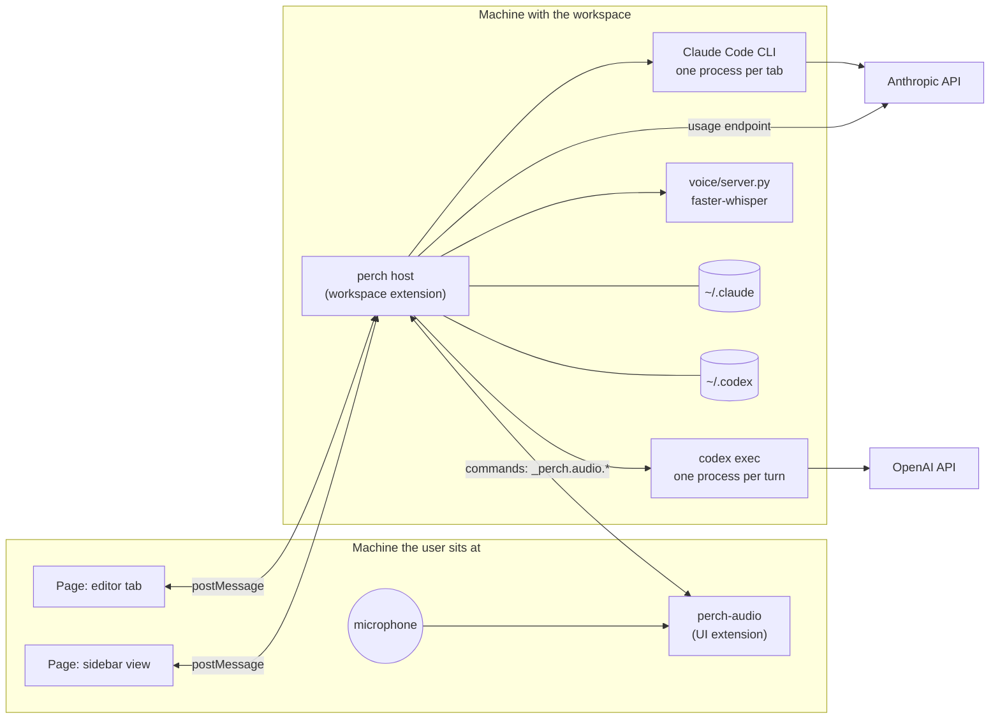

# 104 — Architecture

In a local window both boxes are the same machine. Under Remote-SSH they
are two, and the split between them is what makes dictation possible
([note 112](112-dictation.md)).

## Modules

| File | Lines | Depends on VS Code | Responsibility |
| --- | --- | --- | --- |
| `src/extension.js` | 877 | yes | Sessions, surfaces, routing, persistence, commands, the sessions list |
| `src/webview.js` | 774 | no | The page: markup, styles, and script, as one template |
| `src/markdown.js` | 126 | no | An answer's Markdown, drawn as DOM nodes; written into the page as source |
| `src/sessionStore.js` | 257 | no | Past sessions, their names, and their transcripts, from the agents' records |
| `src/binaries.js` | 52 | no | Where the agents' programs are: the SDK's own, or the vendor extension's |
| `src/claudeAgent.js` | 190 | no | One Claude Code session through the Agent SDK |
| `src/gateway.js` | 95 | no | The gateway file: reading it, what makes it usable, the environment a tab gets, the template |
| `src/relay.js` | 90 | no | The loopback relay between a gateway tab's Claude Code and the gateway: forwards unchanged, reads which model answered |
| `src/codexAgent.js` | 185 | no | One Codex thread through the Codex SDK |
| `src/models.js` | 91 | no | Model and slash-command catalogs, read from the agents |
| `src/meter.js` | 426 | no | Claude usage, cost, the backend switch, cache lifetime |
| `src/codexMeter.js` | 101 | no | ChatGPT plan usage, read from Codex's session files |
| `src/meterHost.js` | 185 | yes | Polling, back-off, the backend switch, login |
| `src/voice.js` | 157 | no | The speech-to-text engine: environment, server process |
| `src/voiceHost.js` | 135 | yes | Dictation: recorder to engine to message box |
| `voice/server.py` | 140 | n/a | faster-whisper behind JSON lines |
| `audio/src/recorder.js` | 120 | no | Microphone capture and device choice |
| `audio/src/extension.js` | 86 | yes | perch-audio's commands |

**A rule the layout enforces:** logic that can be written without the
VS Code API is, and takes its home directory, environment, and
collaborators as parameters. Thirteen of the eighteen files have no VS Code
dependency, which is why most of the behaviour is tested against
throwaway directories and stand-in processes with no editor running.

## Dependencies

| Package | Version | Why |
| --- | --- | --- |
| `@anthropic-ai/claude-agent-sdk` | 0.3.284 | Runs Claude Code. Installed from npm it brings its own CLI; packaged, perch uses the Claude Code extension's |
| `@openai/codex-sdk` | 0.159.0 | Runs Codex. Installed from npm its dependency brings `codex`; packaged, perch uses the ChatGPT extension's |
| `@picovoice/pvrecorder-node` | 1.2.9 | Microphone capture, in perch-audio. Prebuilt for macOS, Linux, Windows |
| `faster-whisper` | 1.2.1 | Speech-to-text, in a private Python environment |
| `jsdom` | 25 | Development only: runs the page script in tests |

Both SDKs are ES modules. The extension is CommonJS, so they are loaded
with a dynamic `import()`.

## Multi-root workspaces

The first folder in VS Code's `workspaceFolders` remains the agents'
working directory. For Codex, every other folder is passed to the SDK as
an `additionalDirectory`, which becomes a `codex exec --add-dir` argument.
Thus **Workspace** mode keeps its sandbox while granting the Codex session
read/write access to every root in a multi-root VS Code workspace; it is
not silently limited to the first folder. Duplicate folder paths are
removed before the thread starts. A running agent keeps the roots it was
started with, so a workspace-folder change takes effect in a new session.
