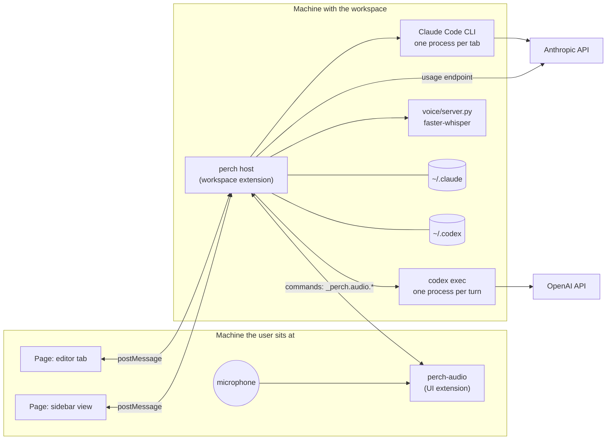

# Architecture

How Perch is built: the parts and their boundaries, sessions and the surfaces they show in, state and persistence across reloads, the page protocol between host and webview, the two agents, and the model catalogs. One file, formerly 6 notes, each a section that keeps its number: links from elsewhere point at `#n<number>`.

- [104 — Architecture](#n104)
- [105 — Sessions and surfaces](#n105)
- [106 — State, replay, and persistence](#n106)
- [107 — The page protocol](#n107)
- [108 — The agents](#n108)
- [109 — Model catalogs](#n109)

<a id="n104"></a>

## 104 — Architecture



In a local window both boxes are the same machine. Under Remote-SSH they
are two, and the split between them is what makes dictation possible
([note 112](110-features.md#n112)).

### Modules

| File | Lines | Depends on VS Code | Responsibility |
| --- | --- | --- | --- |
| `src/extension.js` | 877 | yes | Sessions, surfaces, routing, persistence, commands, the sessions list |
| `src/webview.js` | 774 | no | The page: markup, styles, and script, as one template |
| `src/markdown.js` | 126 | no | An answer's Markdown, drawn as DOM nodes; written into the page as source |
| `src/sessionStore.js` | 257 | no | Past sessions, their names, and their transcripts, from the agents' records |
| `src/binaries.js` | 52 | no | Where the agents' programs are: the SDK's own, or the vendor extension's |
| `src/claudeAgent.js` | 190 | no | One Claude Code session through the Agent SDK |
| `src/gateway.js` | 95 | no | The gateway file: reading it, what makes it usable, the environment a tab gets, the template |
| `src/relay.js` | 90 | no | The loopback relay between a gateway tab's Claude Code and the gateway: forwards unchanged, reads which model answered |
| `src/codexAgent.js` | 185 | no | One Codex thread through the Codex SDK |
| `src/models.js` | 91 | no | Model and slash-command catalogs, read from the agents |
| `src/meter.js` | 426 | no | Claude usage, cost, the backend switch, cache lifetime |
| `src/codexMeter.js` | 101 | no | ChatGPT plan usage, read from Codex's session files |
| `src/meterHost.js` | 185 | yes | Polling, back-off, the backend switch, login |
| `src/voice.js` | 157 | no | The speech-to-text engine: environment, server process |
| `src/voiceHost.js` | 135 | yes | Dictation: recorder to engine to message box |
| `voice/server.py` | 140 | n/a | faster-whisper behind JSON lines |
| `audio/src/recorder.js` | 120 | no | Microphone capture and device choice |
| `audio/src/extension.js` | 86 | yes | perch-audio's commands |

**A rule the layout enforces:** logic that can be written without the
VS Code API is, and takes its home directory, environment, and
collaborators as parameters. Thirteen of the eighteen files have no VS Code
dependency, which is why most of the behaviour is tested against
throwaway directories and stand-in processes with no editor running.

### Dependencies

| Package | Version | Why |
| --- | --- | --- |
| `@anthropic-ai/claude-agent-sdk` | 0.3.284 | Runs Claude Code. Installed from npm it brings its own CLI; packaged, perch uses the Claude Code extension's |
| `@openai/codex-sdk` | 0.159.0 | Runs Codex. Installed from npm its dependency brings `codex`; packaged, perch uses the ChatGPT extension's |
| `@picovoice/pvrecorder-node` | 1.2.9 | Microphone capture, in perch-audio. Prebuilt for macOS, Linux, Windows |
| `faster-whisper` | 1.2.1 | Speech-to-text, in a private Python environment |
| `jsdom` | 25 | Development only: runs the page script in tests |

Both SDKs are ES modules. The extension is CommonJS, so they are loaded
with a dynamic `import()`.

### Multi-root workspaces

The first folder in VS Code's `workspaceFolders` remains the agents'
working directory. For Codex, every other folder is passed to the SDK as
an `additionalDirectory`, which becomes a `codex exec --add-dir` argument.
Thus **Workspace** mode keeps its sandbox while granting the Codex session
read/write access to every root in a multi-root VS Code workspace; it is
not silently limited to the first folder. Duplicate folder paths are
removed before the thread starts. A running agent keeps the roots it was
started with, so a workspace-folder change takes effect in a new session.

---

<a id="n105"></a>

## 105 — Sessions and surfaces

A **session** is one tab: one agent, one context. A **surface** is a page
that shows sessions. There are two kinds.

| Surface | Shows | Tab bar | VS Code API |
| --- | --- | --- | --- |
| Editor tab | one session | VS Code's own | `WebviewPanel`, `WebviewPanelSerializer` |
| Sidebar view | every session that lives in the sidebar | perch's own, in the page | `WebviewView` |

`perch.newTabs` chooses where new tabs open, `editor` by default.

### Why editor tabs

A view docked in a sidebar carries two rows of VS Code's own chrome: the
container icon row and the view title. An extension cannot remove them.
The editor area has neither, so there the tab row is the first line.
This is also how Claude Code's own extension presents its sessions.

### Routing

The host does not assume one page. Each session has a `location`, and
every message is sent to the surface that shows that session:

| Message | Goes to |
| --- | --- |
| A session's events | the surface showing that session |
| `tabs` | the sidebar gets its sessions; each editor tab gets its one, with `single: true` |
| Usage, slash commands | every page |

### Native tab titles

An editor tab cannot draw the status dots that the sidebar's tab bar
does, so status goes in the title:

| State | Title |
| --- | --- |
| Idle | `fix the flush bug` |
| Working | `fix the flush bug …` |
| Permission prompt waiting, tab hidden | `● fix the flush bug` |

### Closing and moving

Closing an editor tab closes the session and stops its agent. The host
tells that apart from a tab that goes away for another reason, a move
or a shutdown, so that neither closes a session by accident.

A tab can be moved between surfaces. The session, its agent, and its
transcript are untouched; only its `location` changes and the new
surface is sent a replay.

### Locking the editor group

VS Code opens a file from the Explorer in the group last used, which
after a message is the session's. So a group that holds only Perch tabs
is locked, as VS Code locks a terminal's, and the file goes to the group
beside it. Two things lock it. The package's `configurationDefaults` put
the session webview (`mainThreadWebview-perch.session`) in
`workbench.editor.autoLockGroups`, which VS Code applies when a session
is the first tab of a group and there is more than one group. And the
host locks the active group when a session's tab becomes active there
and every tab in it is Perch's (`lockGroup`). The only group is locked
too: VS Code honours a lock there as well, and opens the file in a new
group beside it.

VS Code never takes a lock off by itself. A group locked for sessions
that later took files, and then lost its sessions, stayed locked with
only files in it, and a file opened from the Explorer went past it into
a new group (2026-10-14). So the host watches tabs close
(`tabGroups.onDidChangeTabs`). A tab moved to another group is told as an
open there and then a close in the group it left, the closed tab's
`group` being that group. A short while after a Perch tab leaves a group
(`UNLOCK_DELAY_MS`, 150 ms, since a tab that takes the place of another
opens just after the old one closes), the host unlocks the group if it
still has tabs, none of them Perch's, and none of an editor that
`autoLockGroups` locks a group for (a terminal's, by default), whose lock
it may be (`tabsChanged`, `unlockGroups`).

The tab API does not tell whether a group is locked, and
`workbench.action.unlockEditorGroup` is not given a group but a file.
VS Code unlocks the first group, most recently used first and so the
active one first, that has an editor of the file, and the active group if
none has. Before 1.92 it looked only at each group's active editor, and
named the group it found by its place in the window where an id was
wanted, which can be another group (1.90 and 1.91: `editorGroup.index`
passed to `getGroup`). So the host passes a file it has just seen in the
group and open in no other group (either side of a diff counts as open),
or any of its files if the group is the active one. It does nothing
before 1.92, or when the group has no such file. Unlocking a group that
is not locked does nothing.

What is left alone: a group whose every file is open in another group as
well keeps its lock, and so does a locked group left empty
(`workbench.editor.closeEmptyGroups` off), which no file can name. A lock
the user put on such a group by hand is taken off with Perch's, since the
API cannot tell the two apart. `perch.lockGroup` off stops both the
locking and the unlocking; the `autoLockGroups` default stays, as VS
Code's to apply.

### A tab's title

A tab is titled from the start of its first message, until its agent's
record has a title of its own: Claude Code titles a session itself as the
conversation goes on (`ai-title` records), and the sessions list reads the
records. A tab the user has not named takes the record's title when a turn
ends (`getSessionInfo`), and again when the list opens, so a tab and its
row say the same name. Before 2026-10-05 the tab kept its first-message
title and an open session could not be found in the list by the name on
its tab ("review https://github.com/…" on the tab,
"… PR #277" in the list). A name the user gave (`named`,
kept with the tab and written to the record as before) is never replaced.

### Deleting a session

Each row of the sessions list has a bin beside the pencil. It asks first,
in a dialog that waits (the one modal dialog perch shows: the record
cannot be brought back), and then removes the session by its agent's own
means: the Agent SDK's `deleteSession` for Claude, and
`codex delete --force <id>` for Codex, which takes a UUID only and removes
the rollout with its name (`src/sessionStore.js`, `deleteSession`).
Nothing of either agent's store is touched by perch's own hand. A tab open
on the session is closed first, since its agent would write the record
again; the dialog says so. The list opens again afterwards, without the
row.

---

<a id="n106"></a>

## 106 — State, replay, and persistence

### The host owns everything

VS Code destroys and recreates a webview whenever a view is moved
between sidebars, and again on reload. A page therefore cannot be trusted
to hold state. The host records every transcript event, the status, the
busy flag, pending permission prompts, and drafts that arrive for a page
that is not there. When a page announces `ready`, it is sent a replay.

This was learned from a bug: the first version announced "ready" once,
so a moved view showed "starting…" forever and lost its transcript.

**Rule:** any new state the page shows must be recorded in the host and
included in the replay, or it will be lost the first time a view moves.

Details that follow from it:

- Streaming deltas are not recorded. The final text covers them.
- A pending permission prompt replays as a prompt. An answered one
  replays as a one-line note, so it cannot be answered twice.
- History is capped at 2000 events a session.

### Persistence

Saved in `workspaceState` under `perch.sessions.v1`: for each session its
id, kind, title, mode, effort, model, IDE-context flag, location, and the
**agent's own session id**. The transcript is not saved.

On reload a tab resumes by handing that id back to the agent
(`resume` for Claude, `resumeThread` for Codex). The agent has the
conversation on disk. The transcript shown in the tab is read back from
the agent's own record, by `src/sessionStore.js`: the Agent SDK's
`getSessionMessages` for Claude, the rollout file for Codex. The last
thousand entries are shown; a note says how many earlier ones are not.
Until the record has been read, or if it cannot be, the tab says the
earlier transcript is not shown. No tokens are spent on any of this.

A tab's name is saved with the tab and also written to the agent's own
record of the session (`renameSession` for Claude; a line appended to
`~/.codex/session_index.jsonl` for Codex), so the vendors' own clients
show the same name. A name given before the first turn is written when
the first turn ends, since the record does not exist before then.

Tab counters are saved too. Rebuilding them by counting restored tabs
let a new tab reuse the name of an open one; a test caught that.

### Restoring editor tabs

1. The page of an editor tab calls `setState({ sid })`.
2. After a reload VS Code calls `deserializeWebviewPanel(panel, state)`.
3. The host attaches that panel to the session, or disposes it if the
   session is gone, has moved, or already has a tab.
4. VS Code brings a tab back lazily: one behind another has no page
   until it is shown. After a four-second wait, a session with no page
   is checked against the tabs VS Code still holds (`tabGroups`); only a
   session with no tab at all is given one. The first version opened a
   tab for every session without a page, which duplicated the tabs that
   were merely waiting.

A tab saved before editor tabs existed has no `location`. It takes the
current setting, which migrates old sidebar tabs on the next reload.

---

<a id="n107"></a>

## 107 — The page protocol

The page and the host exchange plain JSON with `postMessage`.

### Page to host

| Type | Fields | Meaning |
| --- | --- | --- |
| `ready` | | The page has loaded and wants a replay |
| `send` | `sid`, `text` | A message. Queued if the agent is working |
| `stop` | `sid` | Stop the turn and drop what is queued |
| `unqueue` | `sid`, `qid` | Take a queued message back (the × on its bubble) |
| `permission` | `sid`, `id`, `decision` | `allow`, `always`, or `deny` |
| `setModel`, `setEffort`, `setMode` | `sid`, `value` | A choice from a menu |
| `setIde` | `sid`, `value` | IDE context on or off |
| `setBackend` | `sid`, `value` | A Claude tab's backend from the footer's menu, each this tab's own: `subscription` or `api`, carried to its next process as settings of its own (the tab's `own`), or `gateway` |
| `switchVendor` | `sid`, `kind`, `model`, `effort` | Continue the tab on the destination vendor. `effort: ""` means that model's default (a click on its model row); a contextual effort item sends its explicit value |
| `attach` | `sid` | Open the file picker for mentions |
| `new`, `close`, `activate` | `kind` (and `gateway` for a Claude tab on the gateway) or `sid` | Sidebar tab bar |
| `meterRefresh` | `vendor` | Re-read usage (the usage panel's **refresh**) |
| `subagentUsage` | `sid` | Read a session's usage, thread by thread, Codex's or Claude's (the footer's **sub-agents**); asked again at a turn's end while the table is open |
| `indexStatus` | `sid` | Read codebase search's state: every folder of the workspace with its setting and its index (the footer's **index**, shown while the tab's `index` is true: a folder is open); asked again at a turn's end and every 5 s while the panel is open |
| `searchToggle` | `sid` | Turn codebase search on or off for the workspace: the setting where it is set (the workspace's settings if they have it, else the user's), without the command's message; answered with `indexStatus` |
| `searchFolder` | `sid`, `root`, `on` | Turn codebase search on or off for one folder, in its own settings (`.vscode/settings.json`, the WorkspaceFolder target); answered with `indexStatus` |
| `meterToggle`, `meterLogin` | | Claude backend switch, login |
| `voiceStart`, `voiceStop`, `voiceCancel` | `sid` | Dictation |

### Host to page

| Type | Fields | Meaning |
| --- | --- | --- |
| `tabs` | `tabs`, `active`, `single`, `gateway` | The sessions this page shows; a tab's `switchTo` names the destination vendor and each model's `efforts` and `defaultEffort`; `gateway` says where the gateway file is, whether it exists, and whether it is in order |
| `event` | `sid`, `ev` | One event for one session |
| `meter` | `meter`, `codex` | Claude usage, and ChatGPT plan usage |
| `indexStatus` | `sid`, `at`, `on`, `usable`, `folders`, and `meaning`, or `why`, `error` | The answer: `on` is the workspace's setting, `usable` whether a Python here can run the search; every folder its `name`, `root` and `on` (its own setting as it resolves) and, read from the indexes' files by `server.py --status` (nothing is built), `files`, `sections`, `vectors`, `built`, `updating`, `embedding`, `off`, `ignore`, `updated`; `meaning` says whether search by meaning is installed on the Python the server runs on; `why` when no folder is open or no Python can run it, `error` when the read failed |
| `subagentUsage` | `sid`, `at`, and `main`, `subagents`, `prices`, `backend`, or `error` | The answer: each thread's model, effort, turns, tokens, and `cost` at list prices (null, with `unpriced` naming the model, when the table has no price for one it ran on); a sub-agent's `name`, `thread`, `state`, `first`, `last`, and `missing` when its file is not found |
| `commands` | `kind`, `list` | Slash commands |

### Event kinds

| Kind | Recorded for replay | Shown as |
| --- | --- | --- |
| `user` | yes | A message bubble, tagged if queued or carrying IDE context. A queued one carries `qid`, and an × that sends `unqueue` |
| `dequeued` | no, the `user` it names is changed instead | A turn has taken a queued message up: its bubble is an ordinary one from then on (no ×, not marked queued), and so in what is replayed |
| `unqueued` | no, the `user` it names is removed instead | The answer to `unqueue`: `ok` and the bubble goes (`quiet` when Stop dropped it, the note saying how many); or not, `why` `taken` (its turn had started: an ordinary bubble, and a line saying so) or `unsupported` (a Claude Code that cannot be asked: still queued, without the ×) |
| `text`, `thinking` | yes | The agent's answer, its reasoning |
| `delta` | no | Streaming text in a live bubble |
| `tool_use`, `tool_result` | yes | A tool call with its result beneath. A `tool_use` with `update: true` is the same call said again in full (a Codex web search, on completing): its card is drawn again in place |
| `permission` | yes, becomes a `note` once answered | Allow, Always, Deny |
| `question` | yes, becomes `answered` | Claude's `AskUserQuestion`: choices as buttons, a line of your own, one answer for all. With `async: true`, a question Codex asked without waiting (`request_user_input_async`): the card says so, the tab does not wait on it, and the answers go as the next message (queued behind the turn); read back from an earlier session, it is an `answered` with `answers: null`, what was asked and no answer either way |
| `subagent` | yes, but `waiting` and `usage` are not | Codex: a sub-agent's `started`, `tasked` (a follow-up task), `reported`, `finished`, `interrupted`, a line each (`⤷ name started`); each read from an activity record carries the sub-agent's own `thread`; an end line carries `info`, what its own thread file said of it in the turn it ended in (model, effort, turns, tokens, nickname, every model when more than one), and says it after the words. `waiting`, the root waiting on its sub-agents, is said at the foot; `usage`, read from a sub-agent's own file, goes into the tab's `subagents` and is no line. The tab's `subagents` (working, finished, stopped, and each by name with its reports and its `info` fields once known) is at the foot while the turn runs: a count that opens to a table of them. The turn's `result` carries the same `subagents`, a count under the line that opens to the table |
| `result` | yes | Duration, tokens in, cached, out; through a gateway, `via`: the models that answered the turn's requests, each with a count, and `gatewayCost`, `gatewayCostSoFar`: the gateway's own figures, for the turn and the session; off the gateway, `answered` and `wanted`: the models that answered the turn, as each response named its own, when one is not the model meant ([note 109](#n109)) |
| `note`, `error` | yes | A line in the transcript; a note with `level: 'warn'` in the warning colour (Claude Code's notice of a refusal fallback) |
| `status`, `busy` | latest value only | A working line at the foot of the transcript: what the agent is doing, for how long. A status that is not idle, working, or ready becomes a `note` |
| `fill`, `insert` | no, held as a draft if no page | Text into the message box |
| `voice` | no, re-sent on `ready` | The microphone's state |

Agents emit a few more that the host consumes and does not forward:
`session`, `model`, `context`, `responded`, `commands`, `relay` (one
response through the gateway: which model it came from, folded into the
next `result` as `via` and onto the tab as its last model), and
`fallback` (Claude Code retried a refused response on another model: a
`note`, and the tab's running model, [note 109](#n109)).

---

<a id="n108"></a>

## 108 — The agents

Both agent modules take an `emit` callback and know nothing of VS Code.
They translate the vendor's events into the kinds above.

### Claude

| Aspect | How |
| --- | --- |
| Process | One CLI process per tab, in **streaming-input** mode: `query({ prompt: asyncIterable })` |
| Why one process | Every turn shares the same prompt cache and context |
| Permissions | `canUseTool` calls back on each tool use. The page shows the prompt. "Always" returns the SDK's own suggestions as `updatedPermissions` |
| Mode, model, effort | Live, on the running session: `setPermissionMode`, `setModel`, `applyFlagSettings({ effortLevel })` |
| Queueing | A message sent mid-turn is pushed with `priority: 'next'` and a `uuid` of perch's. Claude Code queues it. Taken back with `cancel_async_message` by that uuid (`query.cancelAsyncMessage`, implemented in the Agent SDK though this version does not declare it; Claude Code answers whether it still had it), or out of perch's own input stream if not yet handed over. Claude Code stamps the uuids a turn takes up (`user_message_uuids`) on the turn's first messages, which is when a bubble stops being queued |
| Context usage | `getContextUsage()` after each turn |
| Slash commands | `supportedCommands()` |
| Stop | `interrupt()` |
| Settings | All sources are loaded, the SDK's default, so the user's `~/.claude/settings.json` applies |
| Environment | The extension host's, plus, for a tab on the gateway, the variables of the user's gateway file (`src/gateway.js`) with `CLAUDE_CODE_USE_BEDROCK=0` unless the file says otherwise; and the same variables, the token left out and the base URL the relay's, as the process's own settings (the SDK's `settings`, Claude Code's `--settings`), which Claude Code applies over `~/.claude/settings.json`. Without that a window set to API / Bedrock there sends the tab to Bedrock whatever its environment says, since the settings' `env` block is applied over the environment |
| Relay | On the gateway, `ANTHROPIC_BASE_URL` is a loopback port of perch's (`src/relay.js`), one per process, started before the CLI and stopped with it. Every request is forwarded to the gateway as it came, path prefix kept, token included, and the response streamed back byte for byte; the relay only reads the gateway's `x-litellm-*` headers, which name the deployment that answered. Nothing a model sees changes. A gateway that sets no such header is relayed the same and reports nothing |
| System prompt | The SDK's default, not Claude Code's full prompt: about 6,400 tokens smaller ([note 103](101-purpose-and-rationale.md#n103)) |
| Questions | `AskUserQuestion` arrives through `canUseTool`; the answers go back as `updatedInput.answers` |
| Images | Pasted images go as base64 `image` blocks before the text |

Claude Code auto-approves a set of read-only shell commands such as
`echo` without prompting. That is the agent's behaviour, not a gap in
perch. A `Write` prompts every time in default mode.

### Codex

| Aspect | How |
| --- | --- |
| Process | The SDK wraps `codex exec`: one process per turn, one thread across turns |
| Approvals | **By policy, not by prompt.** `codex exec` is non-interactive. `perch.codex.approvalPolicy` and the sandbox decide |
| Model, effort, sandbox | Changed from the next turn: the thread is taken up again (`resumeThread`) with the new options. Codex compacts once and notes the model change |
| Images | Written to a private temporary directory and passed as `local_image` inputs; removed with the agent |
| Queueing | One turn at a time, so **perch holds the queue** and drains it as each turn ends, without the tab flickering to idle. Each entry has an id; one taken back leaves the queue and its echo is no longer awaited (by place, not by words, since two queued messages may say the same) |
| IDE context | Attached by perch (below) |
| Stop | An `AbortSignal` on the turn |
| Web searches | The SDK's `web_search` item says nothing when it starts (an empty `query`, the action `other`) and everything when it completes: the action (`search` with its query or `queries`; `find_in_page` with the pattern and page; a page opened stays `other`, the page being the result) and the `results`, each with its title and address. The card is drawn at the start (`web search …`) and drawn again in place from the completion (`webInput`), with the pages found under it, eight at most (`webFound`); the foot says *Searching the web* in between. Reading only the start left `{"query": ""}` cards and a foot that said *Running web_search* for minutes after the searches ended (seen on 2026-10-12, in a turn whose last search had finished four minutes before) |
| Apps and plugins | Codex's own: `codex exec` loads the plugins installed in the ChatGPT account of its login (the `openai-curated-remote` marketplace, cached under `~/.codex/plugins/cache/`) and reaches their apps through ChatGPT's hosted `codex_apps` MCP server; installing is `codex plugin add <name>@<marketplace>` (or `/plugins` in the interactive CLI, or the ChatGPT apps), and the model's own plugin tools can search, suggest, and uninstall but not install. An app's connection (its OAuth, Microsoft's for SharePoint) is made on chatgpt.com and kept by ChatGPT. A call to an app that is not connected returns `connector_auth_failure` in the result's `_meta` with an `install_url`; neither the result's text nor the model sees it, so perch says it in a note with a **Connect on ChatGPT** button (`connectLink` in `src/codexAgent.js`, chatgpt.com links only, once a turn). Read-only use is Codex's config: `apps.<connector_id>.destructive_enabled = false` |
| Sub-agents and questions | Not in the SDK's stream, which carries agent messages, commands, file changes, MCP calls, reasoning, todo lists, web searches, and errors. The rest is in the thread's rollout file, so while a turn runs perch reads the lines it gains (`src/codexWatch.js`, from where the file ended when the turn began, or from its start for a new thread, about once a second, and once more before the turn is said to end) and translates them (`collabEvent` in `src/sessionStore.js`): `SubAgentActivity` items (started, interacted, completed, interrupted), a sub-agent's reports to `/root` (`agent_message`, MESSAGE as it goes and FINAL_ANSWER at the end of a task, their words encrypted, so only that a report came is shown), the root's `followup_task` and `wait_agent`, and `request_user_input_async`. The same translation reads them back into an earlier session's transcript, where the collaboration calls and their outputs (encrypted messages, `{"accepted":true}`) are no longer shown as tool calls. A turn's sub-agents end with its `codex exec` process. Each sub-agent is a thread of its own, with a rollout file of its own that every one of its activity records names (`agent_thread_id`), so one started in an earlier turn is found by this turn's follow-up (`interacted`). Seen on 2026-10-12, when only a start was read: a follow-up to a sub-agent started three days before left its row saying `…`. The watch reads that file too, from its start, for three records only (`turn_context`, the model and effort of each of its turns; `token_usage_record`, what each cost; `session_meta`, the nickname Codex gives it), tallied in `UsageTally` (`src/sessionStore.js`) and said as the sub-agent's `usage`: the model and effort of its latest turn whenever that was, and the turns and tokens of this turn only, those stamped from the watch's start on. The sub-agents' files are read before the root's on each poll, so a sub-agent's end finds its usage known. Read back later, `addSubagentUsage` gives each end line the same: the turn it ended in, from that turn's `task_started` to the end, so a sub-agent that ended in several turns shows each turn's model and cost and not its whole life. Each thread's file is read and parsed once, and the sessions tree walked once, for all of them. Seen on 2026-10-09: a thread's turn spawned three sub-agents that worked for 14 minutes while the tab showed only the root's last command, and an async question was never seen |
| Backends | Three, perch's own choice (`perch.codex.backend` in global state), given per process so a tab moves on its next turn: the ChatGPT login (nothing given); an OpenAI API key (`CODEX_API_KEY`, from VS Code's secret storage); Amazon Bedrock (`--config` overrides through the SDK's `config`: `model_provider` and `model_providers.<provider>.aws.{region,profile}`, `src/codexBedrock.js`). Codex 0.159 has the Bedrock provider built in, in two forms: `amazon-bedrock`, the Bedrock Mantle endpoint (`bedrock-mantle.<region>.api.aws/openai/v1`), and `amazon-bedrock-runtime`, the runtime's OpenAI-compatible endpoint; both sign with the AWS credential chain (profile, `AWS_*`, `AWS_BEARER_TOKEN_BEDROCK`). On Bedrock a model goes by its Bedrock id: `openai.<slug>` on Mantle, `us.openai.<slug>` on the runtime endpoint (on-demand throughput there wants a cross-region inference profile; `openai.gpt-6-luna` alone is refused), and a tab with no model of its own sends the catalog's default slug in that form, since Codex's own default (`config.toml`) is not a Bedrock name. The ChatGPT connector apps (`features.apps`: Gmail, Calendar, ChatGPT spaces and the rest) are turned off for a Bedrock process: they are features of a ChatGPT account and cannot work there, and for a model Codex's catalog does not know by its cross-region id Codex sends every one of their schemas in full with each request (captured 2026-10-06 against a stand-in endpoint: 236 KB a request with 25 tools on the runtime endpoint, 44 KB with 11 once the apps are off; Mantle with its recognised id and the apps on, 51 KB with `tool_search` deferring them). Measured with GPT-6 Luna and a one-line prompt, apps off: the runtime endpoint 7.9 K input tokens a request, Mantle 9.2 K (with the apps on they had been 37.5 K and 12.4 K). So the runtime endpoint is the default: every Bedrock region, the `bedrock:*` actions a machine on Claude-on-Bedrock already has, and the leaner request; Mantle is the setting, wants its own IAM action (`bedrock-mantle:CreateInference` on a project resource, which a key for Claude on Bedrock may lack) and is not in every region (us-west-2 answered 404 for every model), so its region defaults to us-east-1 while the runtime endpoint follows the machine's. A thread cannot cross between OpenAI and Bedrock: its reasoning items are `encrypted_content`, encrypted for the provider that made them, and the other refuses them (`invalid_encrypted_content`, seen 2026-10-06 when a ChatGPT thread was resumed on Bedrock). So a switch across providers starts a new thread with the next message, said in a note, and a thread resumed from the sessions list on the other provider is started over once and the message sent again; the old thread stays on record. ChatGPT and the API key are the same provider, and a thread goes on between them |

### IDE context

On both kinds of tab; on by default for new tabs (`perch.ideContext`), and
kept per tab. When on, a message carries the active file and, if there is
one, the selection:

````
why is b 2?

<ide_context>
Active file: src/a.js (javascript)
Selection: lines 3-4
```javascript
const a = 1;
const b = 2;
```
</ide_context>
````

- The transcript shows the message and a tag, `IDE context · src/a.js:3-4`,
  not the attachment.
- It is read **when the message is written**, so a queued message keeps
  the file that was open then.
- A selection over 12000 characters is cut, and says so.
- The code fence is made longer than any run of backticks inside.
- Unsaved and non-file editors attach nothing.

---

<a id="n109"></a>

## 109 — Model catalogs

Lists are read from the agents, never hardcoded. An earlier hardcoded
Codex effort list was wrong: it offered `minimal`, which no listed model
accepts, and lacked `max` and `ultra`.

| | Claude | Codex |
| --- | --- | --- |
| Models | `supportedModels()` | `~/.codex/models_cache.json`, entries with `visibility: list` |
| Efforts | per model, `supportedEffortLevels` | per model, `supported_reasoning_levels` |
| Default model | the model the idle CLI says it is on, `getContextUsage({ detail: 'summary' }).model`, named by the entry that is it or resolves to it; the SDK's `default` entry if the CLI cannot say | `model` in `~/.codex/config.toml` |
| Default effort | not reported | `model_reasoning_effort` in the config, if the model accepts it |
| Cost to read | about 0.7 s, no request | a file read |

**Reading Claude's list without a request.** The CLI is started with an
input stream that never yields. It initializes, answers
`supportedModels()`, `getContextUsage({ detail: 'summary' })` and
`supportedCommands()`, and is stopped. No message is sent, so nothing is
billed; the summary is worked out from local figures.

**Effort follows the model.** Changing the model rebuilds the effort
list. An effort the new model does not accept resets to default. A model
with no effort control, Haiku for one, says so. On Claude's default the
model is the one the session reports (below), so there the check is made
when it reports.

**Defaults are labelled.** `default · Sonnet 4.6`, `default · ultra`.

On Claude, default is two models. A new session starts on
`ANTHROPIC_MODEL`, else the settings' `model`, else Claude Code's
built-in default; `setModel(undefined)` in a running session goes to the
built-in default, whatever the session started on. The SDK's `default`
entry names the built-in one in both cases, and the label used to come
from it, so a machine that sets `ANTHROPIC_MODEL` to Sonnet 4.6 showed a
tab running Sonnet as default Opus and offered it Opus's `xhigh`. So:

- Before a tab's process starts, the label is the model the idle CLI
  says it is on, read with the catalog.
- Once it runs, the label is the model the process reports: the `model`
  of its `init` message and of each context reading. After a model
  change Claude is asked at once; until it answers, the label is the
  start model's.
- A reported id is named by the catalog entry that is it or resolves to
  it, and shown as it is when the list lacks it.
- The effort list follows the same model. An effort the reported model
  lacks resets to default when the report arrives, and again when the
  process is restarted, since the next one starts on the start model.
- The option's tooltip says when the running model is not the one new
  sessions start on. A gateway tab's default is the file's ([note 111](110-features.md#n111)).

**Refusal fallback.** Claude Code moves a session itself when a model's
safeguards refuse a response: it retries the response on a fallback
model, takes the refused one back, and keeps the session on the fallback
(`model_refusal_fallback` with scope `session`; scope `local` is one
response of a sub-agent or a side question). Seen on 2026-10-20: Opus 5.5
to Opus 4.8, category `cyber`, while the pill still said Opus 5.5. So:

- The fallback model is the one the session runs from then on, until a
  model is chosen or the process restarts. A context reading that names
  the model asked for does not undo it.
- When the model running is not the one meant (the one chosen, by the id
  it resolves to; on default, the one Claude Code moved the session
  off), the pill names the running one, in the warning colour, and its
  tooltip says why. Ids are compared by the model they name, so a
  provider's id (`us.anthropic.claude-opus-5-5-v1:0`) is that model.
- Claude Code's notice is a `note` with `level: 'warn'`. The Agent SDK's
  reader gives a past session's system records without their words, so
  a past transcript reads those from the session's own file.
- Each main-thread response names its model (`message.model`). The
  turn's `result` lists them, less any a fallback took back
  (`supersedes`, `retracted_message_uuids`), and its line says
  `answered by` when one is not the model meant. The gateway's own
  `via` does this for a gateway tab.

**Fallback.** Until a catalog loads, or if it cannot, tabs use a static
effort list and offer only the default model. A catalog that arrives
after a tab exists corrects that tab.
