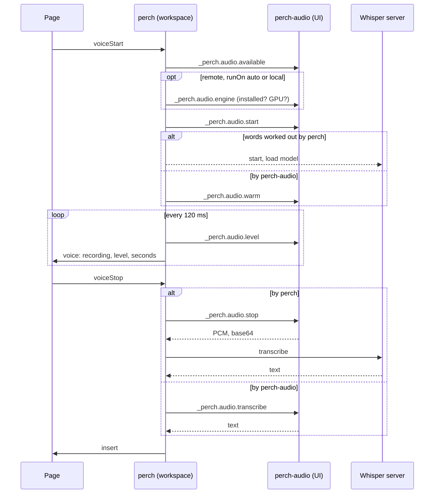

# Features

The composer, the usage meters and the footer, dictation, and what Perch does and does not do with the user's data. One file, formerly 4 notes, each a section that keeps its number: links from elsewhere point at `#n<number>`.

- [110 — The composer](#n110)
- [111 — Usage meters](#n111)
- [112 — Dictation](#n112)
- [113 — Security and privacy](#n113)

<a id="n110"></a>

## 110 — The composer

One composer, shared by all tabs on a page, reflecting the active tab.
It takes its vendor's look through a class on the container and CSS
`order`, so both layouts are the same elements.

### Claude tab

| Tool | Data |
| --- | --- |
| **+** | File picker. Inserts `@relative/path` |
| **/** | Slash commands. Typing `/` opens the same list |
| Ring | Context used. Amber at 80%, red at 95% |
| Clock | Minutes until the prompt cache goes cold |
| Pill | Model and effort, opens a menu |
| Bolt | Permission mode: Ask, Edits, Plan, Auto, Bypass |
| Microphone | Dictation |
| Square | Send, or Stop |

### Codex tab

**+**, the sandbox behind a shield (Full access in amber), the model with
its effort and a chevron, IDE context, the microphone, and a round send
button. The Codex extension's "Work locally" chooser is not copied: the
SDK runs local threads only (no cloud option), and a label styled like
the vendor's chooser read as a broken switch; it was taken out on
2026-10-02.

### The cache clock

How long Claude Code keeps the prompt cache warm, by Claude Code's own
rule (read from the 2.1.119 binary; `src/meter.js`, `promptCacheMinutes`):

1. `FORCE_PROMPT_CACHING_5M` set: five minutes.
2. `ENABLE_PROMPT_CACHING_1H` set (on Bedrock,
   `ENABLE_PROMPT_CACHING_1H_BEDROCK`): one hour.
3. Otherwise one hour on a claude.ai login, five minutes on an API key,
   a gateway token, Bedrock, Vertex, or Foundry.

The variables are read as Claude Code sees them: the settings files'
`env` blocks over a gateway file's variables over the process
environment. A running tab keeps the lifetime of the backend it started
on.

The clock counts down from the last request, not the last answer: the
agent says `responded` when each response of a turn begins (the SDK's
`message_start`, which the request that touched the cache brought), and
again at the turn's end. Counting from the turn's end only, as it first
did, left the pill reading "cold" all through a turn that began after an
expiry, however long the turn ran and however many requests had warmed
the cache since (seen on 2026-10-05). A subagent's requests are another
conversation's cache and do not restart the clock.

### Slash filter

A filter of one or two letters matches command **names** only.
Descriptions are searched from three letters. Otherwise `/c` matched
`/model`, whose description contains a "c".

---

<a id="n111"></a>

## 111 — Usage meters

The footer follows the active tab.

### Claude

Ported from [AI Meter](https://github.com/seanahn/ai-meter), by the same
author, and merged in rather than called across extensions.

**Subscription mode.** `GET api.anthropic.com/api/oauth/usage`, with the
OAuth token Claude Code stores in `~/.claude/.credentials.json` or the
macOS Keychain. Polled every five minutes and cached in `globalState`,
so the gauge is there at once after a reload.

**Cost mode.** Used when Claude is configured for Bedrock or API, where
there is no quota to report. Tokens and estimated cost are computed from
the transcripts under `~/.claude/projects/`. Files are read
incrementally, and one message, which produces a line per content block,
is counted once.

Prices used, in dollars per million tokens:

| Model family | Input | Output |
| --- | --- | --- |
| Fable, Mythos | 10 | 50 |
| Opus 5 and 4.5 to 4.8 | 5 | 25 |
| Opus 4.0, 4.1, 3 | 15 | 75 |
| Sonnet | 3 | 15 |
| Haiku 4 | 1 | 5 |
| Haiku 3.5 | 0.8 | 4 |
| Older Haiku | 0.25 | 1.25 |

A model that matches none of these is counted in tokens and shown as
having no price data, rather than priced by guess.

Cache reads bill at 0.1 times input; cache writes at 1.25 times for a
five-minute lifetime and 2 times for an hour. These are list prices.
Bedrock or partner billing may differ.

**Failures are classified by HTTP status.**

| Status | Read as | Response |
| --- | --- | --- |
| 429 | rate limited | Keep the reading, mark it stale, wait |
| 401, 403 | login expired | Offer login |
| 5xx | network | Retry |
| 200, unusable body | bad response | Retry |

**Back-off.** After a 429 perch waits at least a minute, doubling to
half an hour and honouring `Retry-After`, and makes no request in that
time even when refresh is clicked. The original read a 429 as a
malformed body and retried every 15 seconds, which prolongs a rate
limit.

**The backend switch** (`Perch: Toggle Claude Backend`) writes
`env.CLAUDE_CODE_USE_BEDROCK` in `~/.claude/settings.json`: the window's
default, for tabs that have not chosen a backend of their own and for
`claude` in a terminal.

- The settings value wins over an exported environment variable, and
  `settings.local.json` over `settings.json`. Verified against Claude
  Code by AI Meter.
- Model pins are backend-specific. Switching to subscription sets aside
  a Bedrock model id and blanks provider-prefixed `ANTHROPIC_MODEL` pins.
  Switching back restores them.
- The file is written atomically, by rename.
- A settings file that is not valid JSON is **refused**, not replaced.
- An open Claude tab that follows the window moves to the new backend
  (a tab given a backend of its own in the footer's menu, carried to its
  process as settings of its own, stays): its process ends (after
  the current turn, if one is running) and the next message resumes the
  session on the new backend, as after a window reload. The transcript
  and the session id stay; the prompt cache starts over, being a
  property of the backend. The tab is told so.

**A backend of the tab's own (0.7.12, 2026-10-29).** The footer's menu
chooses for this tab alone, all three entries: subscription, API /
Bedrock, or the gateway. Subscription or API / Bedrock is kept on the
tab (`own`, saved with it, carried across a vendor switch) and given to
its next process as settings of its own — `CLAUDE_CODE_USE_BEDROCK` and
the model slots, as `ownBackendSettings` in `src/gateway.js` makes them,
the same mechanism that takes a tab off a pinned gateway — which Claude
Code applies over `~/.claude/settings.json`. So two tabs run on different
backends side by side, nothing is written to the file, and the window's
switch leaves such a tab where it is. A process already on the backend
asked for is not restarted. The catalog of the other backend is loaded
once when a tab first needs it (`claudeCatalog`), the window's serving
meanwhile with names mapped across backends. The footer's pill shows the
tab's backend; where the window's reading does not apply (a tab on API
under a subscription window, or the reverse), the reading shows `—` and
the usage panel says whose reading it is. The held-message notes and
the login dialog act on the tab's own backend. Outside Perch nothing
changes: a terminal `claude` reads only the file.

**The gateway** is a third backend, a tab's own rather than the window's.
A gateway is an Anthropic-compatible endpoint reached with
`ANTHROPIC_BASE_URL` and a token, as a company's LLM proxy is. The user
keeps its variables in a file written as a shell reads it
(`export KEY=VALUE`), `~/.config/gateway-claude/env` by default
(`perch.claude.gatewayEnv`), so one file serves a terminal launcher and
perch. A tab on the gateway gets the file's variables added to its
process's environment (`src/gateway.js` reads the file each time a
process starts, or a `tabs` message is built: it is small, and the user
may be editing it). Nothing else changes: `~/.claude/settings.json` is
not written, the token is never in a file of perch's, and the session
record, `CLAUDE.md`, memory, and MCP servers are those of any other tab.
Verified: with an OAuth login present in `~/.claude`, Claude Code
authenticates with the environment's bearer token at the environment's
base URL and leaves the login alone ([note 115](114-quality-and-open-work.md#n115)).

- The choice is a field of the session, saved with it. Moving a tab onto
  or off the gateway ends its process and resumes the session, as the
  window's switch does; the window's switch leaves tabs on the gateway
  alone.
- A gateway tab's first message is held when the file is missing or sets
  no URL or token, or when the window is on API / Bedrock, since Claude
  Code's settings win over a process's environment. The offers: open the
  file (made from a template, mode 600, never over an existing one), use
  the subscription, or take the tab off the gateway.
- The gateway is a backend of a Claude tab, not a kind of tab. It is
  chosen in the footer's backend menu under any Claude tab, where the
  entry reads **LLM gateway** (this tab only), beside the window's two;
  the picker, **+** and the sessions list offer Claude and Codex only.
  A kind of its own ("Claude on the gateway", then "LLM gateway", with
  its own numbering and icon) was tried on 2026-10-02 and taken out the
  same day: the tab's prompt, tools, permissions, `CLAUDE.md`, skills and
  record are all Claude Code's, and only the route differs, so a second
  identity in the tab bar said the wrong thing. The name "LLM gateway"
  stayed, since the client being Claude Code matters less than the router
  behind it, which is what the tab is of; the file, the setting and the
  code keep the plain word "gateway", which fits anyone's proxy.
- The choice sticks. Once a tab is put on the gateway, new Claude tabs
  start on it (`perch.claude.newTabsOnGateway` in global state, since the
  gateway file is the machine's), until a tab is put back on the
  subscription or API / Bedrock from the same menu; those two stick
  through Claude Code's own setting, as before. The first-message help's
  "Leave the Gateway" moves one tab and changes no default.
- The gateway's model menu is the file's names, not Claude Code's
  catalog: the default is `ANTHROPIC_MODEL`, and opus, sonnet and haiku
  are what `ANTHROPIC_DEFAULT_*_MODEL` map them to (`src/gateway.js`,
  `gatewayModels`), which is what the gateway receives, because those
  three aliases are exactly what Claude Code translates through those
  variables and a catalog id such as `claude-fable-5-1` would go out
  untranslated to a router that has no such name. Effort offers the usual
  levels, a router's names saying nothing of it. A tab moved onto the
  gateway with a catalog model chosen starts from the file's default, so
  the pill never names a Claude model while the gateway answers; an alias
  survives the move back.
- A tab whose file is missing or incomplete holds its first message,
  puts it back in the box, and says why in a note. The two ways on, the
  file (made from the template if absent) and the tab off the gateway,
  are buttons under that note (a note event may carry `actions`; the page
  posts `noteAction`), where they stay: the notification beside them,
  which says more, hides itself after a few seconds, and on a first run
  that was the whole of the guidance. Each button is safe to press again,
  since an old note keeps its buttons. The other first-message holds
  carry theirs the same way: Claude on API / Bedrock with no credentials
  (Open settings.json, Use Subscription), Claude on the subscription with
  no login (Log In, Use API / Bedrock), and Codex with no login (Log In,
  Device Code). A button acts only on what still applies: Use
  Subscription does nothing in a window already on it, Log In says so
  when the login is already there, and a login taken from a button runs
  without the notification, which may be gone or still waiting unseen
  in the notification centre. The Codex sign-in is one run at a time
  whichever asked for it, since it listens on a fixed port.
- With no `ANTHROPIC_MODEL` in the file the model button reads
  "default" and its tooltip says to set one. It first read "the gateway's
  default", which was wrong as well as long: the gateway does not choose,
  Claude Code sends the name it would use anyway (the environment's
  `ANTHROPIC_MODEL`, or its own default), which a gateway may not know.
- The template turns the hour-long prompt cache on (`ENABLE_PROMPT_CACHING_1H=1`).
  Claude Code's rule, read from the 2.1.119 binary: `FORCE_PROMPT_CACHING_5M`
  forces five minutes, `ENABLE_PROMPT_CACHING_1H` forces the hour (Bedrock
  needs `ENABLE_PROMPT_CACHING_1H_BEDROCK`), and otherwise the hour goes only
  to a claude.ai login that is not in overage, which an `ANTHROPIC_AUTH_TOKEN`
  is not, so a gateway tab would send no `ttl` and get five minutes. On a
  per-token bill the hour costs 0.75× more on each write and saves a whole
  re-write of the context at the first pause over five minutes; with a 150 K
  context one pause an hour pays for it several times over, so the file
  turns it on and says what to remove if the gateway rejects it. The cache
  pill reads the same three variables, from settings.local.json's env block
  over settings.json's over the gateway file over the process (the order
  Claude Code applies them); overage is not visible to it.
- The gauge shows nothing under a gateway tab. The gateway's usage is its
  own, and the cost-mode figures would be at Anthropic list prices for
  names the gateway may map to anything. The result line under each
  answer still shows the tokens.
- The cache clock assumes five minutes, the API's lifetime.
- **Which model answered.** A routed name is resolved per request, and
  the gateway's answer body carries the alias, not the deployment; the
  Agent SDK surfaces no response headers. So the tab's process goes
  through the relay ([note 108](104-architecture.md#n108)), and the gateway's `x-litellm-model-name`
  is read off each response. The host counts them per turn and puts them
  on the `result` (`via gpt-6-luna ×3, grok-4.6` under the answer: a turn
  is several requests, and the router may send each somewhere else), and
  the last one on the tab, for the model button's tooltip. The same
  headers carry the gateway's own
  price for each response (`x-litellm-response-cost`); the host sums
  them per turn and the result line shows that figure in place of
  Claude Code's `total_cost_usd`, which prices a gateway's names by
  guess (≈$0.045 against the gateway's $0.0021 for one "hello" on
  Luna). The session's sum is saved with the tab. But LiteLLM puts that
  header only on a response it has finished pricing, and a streamed one
  is not priced when its headers go out: Claude Code streams every
  request, so a tab never sees it (measured 2026-10-02: the same request
  unstreamed carried `x-litellm-response-cost: 0.000918`, streamed it
  carried the zeroed `-original`, `-input`, `-output` parts and no cost).
  So each response's token counts are priced by the host at the
  answering model's list rates. The counts are taken from the response's
  own stream, when it ends (`claudeAgent.js`: the largest value of each
  field across `message_start` and `message_delta`, per conversation,
  said at `message_stop`), not from the SDK's assistant message: a
  gateway in front of another vendor's model sends zeros at the start and
  the real counts in the closing delta (measured 2026-10-05: start
  `input 0, output 0`, end `input 9, output 17`), and a figure taken at
  the start read ≈$0.0000 for a turn that had written 92,842 tokens. They
  are priced
  (`src/prices.js`): the relay's model names are queued per turn in
  order and each `usage` takes the next, so a turn of two requests on
  Luna and one on Grok is three requests at their own rates. The rates
  are LiteLLM's public table (`model_prices_and_context_window.json`,
  the one the gateway prices with, short of a deployment's own
  overrides), fetched once a week into the extension's global storage,
  and a name is looked up as the gateway spells it and then without its
  region and provider prefixes (`global.openai.gpt-6-luna` →
  `openai.gpt-6-luna`; `xai/grok-4.6` as is). The result line shows that
  figure with `≈` when the gateway gave none, and the tooltip says the
  reckoning; for the `hello` that Claude Code priced at ≈$0.594 as Opus
  the Luna rate gives ≈$0.012. The gateway also puts the token's running
  total on every response (`x-litellm-key-spend`, every use of the token
  included, and not quite monotonic across the gateway's replicas); the
  host keeps the last seen and the tooltip states it, since it is the
  one figure that is the gateway's own. Observed on a gateway with routed names: a routed name sent trivial
  and code prompts to one model and a proof to another, and a one-word
  turn from Claude Code went to a third through a fallback. The agent is Claude Code; the
  model is whatever answered, and the tab now says which.

**The usage panel (2026-10-28).** The footer's reading is compact by
design; the detail is a panel, the same control under both vendors, from
note 401's proposal. The **usage** button and the reading both toggle it.
It shows the backend, the plan as the vendor reports it (ChatGPT's plan
name and credits; Anthropic's usage endpoint names no plan, so none is
invented), each window with its level in words as well as colour and its
reset time, the cost estimate under API / Bedrock marked as an estimate,
the gateway's silence, a stale reading marked stale, and when the reading
was made. Refresh and login are buttons in it rather than a click on the
numbers; the account's usage page is a link. The Codex-only plan badge
is gone. The page holds the panel's open state; the host acts on nothing
until a button asks (`meterRefresh`, `meterLogin`, `openExternal`). One
of the footer's three panels is open at a time, and Escape closes it
before it reaches the composer.

**No status bar items.** The gauge is the footer of each tab, where it
follows the tab's vendor. An earlier version put AI Meter's two items in
the status bar as well, standing down while that extension was installed;
they showed Claude's figures under a Codex tab too, and were removed.

### Codex

After every turn Codex appends a `token_count` event to the session's
rollout file under `~/.codex/sessions/YYYY/MM/DD/`. It carries the plan's
limits:

```json
"rate_limits": {
  "primary":   { "used_percent": 4.0, "window_minutes": 300,   "resets_at": 1790719106 },
  "secondary": { "used_percent": 1.0, "window_minutes": 10080, "resets_at": 1791305906 },
  "plan_type": "plus"
}
```

perch reads the newest such event, from the last 256 KB of the newest
files.

- No request is made, so there is nothing to rate-limit.
- The reading is as old as the last Codex turn on the machine, from any
  client. The tooltip says when.
- **A window whose reset has passed is shown as full.** Otherwise a
  reading from yesterday would show a nearly empty window that has long
  since reset.
- perch re-reads after each Codex turn it runs.

### A session's usage, thread by thread

Built for Codex first (below), and given to Claude tabs on 2026-10-27, from Claude Code's own
records: the session's file for the main thread, and for each sub-agent the file Claude Code 2.1
keeps under `<session>/subagents/` (`agent-<id>.jsonl`, with `agent-<id>.meta.json` naming it and
the Agent call that started it; the call's result in the parent's file says it finished). A response
comes as one record per block, each with the response's usage so far, so it is counted once, at its
largest figures; `input` counts every token sent, cached and written among them, as Codex's does; a
turn is a prompt of the user's, attributed to the model that answered it. Priced at Anthropic's list
rates from the same LiteLLM table; on a subscription the figures say where the work went. Read from
this session's own files: 387 turns, 1.03 G input tokens of which 1.015 G from the cache, 3.4 M out,
two models over its life, and one sub-agent.

The plan's limits say how much is left, not where it went. A session that
starts sub-agents spends in many threads at once: the user's own thread on
2026-10-12 had 76 sub-agents, which together took 42 % of the session's
cost. Under a Codex tab, the footer's **sub-agents** button opens a table
of the whole session, one row per thread: the main thread first, then each
sub-agent it started (and any those started, by path, `alpha/deep`), then
the sub-agents' total and the session's. Each row has the model and effort
(every model, with its turns, when the thread moved), turns, input with
the cached part of it, output, the cost at list prices, and its share of
the session. The sub-agents sort by any column; by cost until another is
chosen.

- **Read from the files, on demand.** The host reads the session's rollout
  file and each sub-agent's own (`sessionStore.sessionUsage`): the threads
  from the `SubAgentActivity` records, each thread's tally from its own
  `turn_context` and `token_usage_record` records, whole. Nothing is kept
  in perch's state. The table is read when opened, and again when a turn
  ends while it is open. The user's thread (95 MB, 76 sub-agent files) reads
  in under a second.
- **A turn is counted once, by its id.** A turn records its context again
  after a compaction: 21 of that thread's 205 turns did. Counting records
  showed 226.
- **A fork's copy of its parent's history is not its own.** A sub-agent
  forked from the conversation has the parent's history copied into the top
  of its file, contexts included: 390 copied against 161 of their own, in
  those 74 files. The sub-agent's own `session_meta`, the file's first
  line, names where its own records begin
  (`subagent_history_start_ordinal`), and `UsageTally` skips the records
  before it. Before this, every forked sub-agent showed a turn more than it
  had, on its parent's model, in the foot's table and on its end line too.
  Token records are never copied (none of the 2,121 in those files names
  another thread), so the token figures were right.
- **Priced per model, at list rates.** Each request's tokens go under the
  model of the turn they are in, so a thread moved to another model is
  priced at each one's rates: uncached input, input written to the cache,
  cached input, and output, from LiteLLM's public price table, the same one
  a gateway's turns are priced with. A thread with a model the table does
  not price shows no cost, and says which model; shares are then of tokens.
- **What the cost means.** On a ChatGPT plan nothing is billed per token:
  turns count against the plan's limits, and the cost says where the work
  went. On an API key it is what OpenAI's list prices charge; Bedrock bills
  at its own rates. The tooltip says which.

---

<a id="n112"></a>

## 112 — Dictation

### The constraint that shapes it

perch runs with the workspace. Under Remote-SSH that is another machine,
and the microphone is not on it. A webview cannot open a microphone
either. So dictation is two extensions:

| Part | `extensionKind` | Runs on | Does |
| --- | --- | --- | --- |
| **perch-audio** | `ui` | the machine the user sits at | Records; transcribes when that machine is the one with the GPU |
| **perch** | `workspace` | the machine with the workspace | Transcribes otherwise; decides which |

OpenAI's Codex extension is built the same way, with a `codex-audio`
companion, for the same reason.

**Where the words are worked out** (`perch.voice.runOn`): both
extensions carry the same engine (`src/voice.js` and `voice/`, copied
into perch-audio by `make audio-engine`, so each package is whole). With
no remote they are one machine and perch's own engine is used. Under
Remote-SSH, `auto` asks perch-audio whether its machine has an NVIDIA
GPU (`nvidia-smi -L`, once) and, if so, has it transcribe: a desktop
with a GPU keeps its own audio, and a CPU-only container is spared the
work; only the text crosses. Otherwise the audio crosses and perch
transcribes, as before. `local` and `remote` force either. Each side
sets up its own environment, in the same place
(`~/.local/share/perch/voice`) so that on one machine the two share it.



The model starts loading when recording begins, so it is ready by the
time the user stops speaking.

### perch-audio

Internal commands, prefixed with an underscore:

| Command | Returns |
| --- | --- |
| `_perch.audio.available` | `{ ok, api, devices, states, device, busy }` |
| `_perch.audio.start` | `{ ok, id, device, sampleRate, maxSeconds }` |
| `_perch.audio.level(id)` | `{ level, seconds, ended, silent }` |
| `_perch.audio.stop(id)` | `{ pcm, sampleRate, seconds, silent, ended }` |
| `_perch.audio.cancel(id)` | `{ ok }` |
| `_perch.audio.engine(opts)` | `{ ok, installed, gpu, home, host }` (api 2) |
| `_perch.audio.setup(opts)` | `{ ok }` after the one-time setup there, with its progress shown there |
| `_perch.audio.warm(opts)` | `{ ok }`; loads the model |
| `_perch.audio.transcribe(id, { engine, language, prompt })` | `{ text, language, seconds, silent, ended }`: stops the recording and transcribes it there |
| `_perch.audio.unload()` | `{ ok }` |

`opts` are the engine settings (`model`, `device`, `python`, `idleMs`),
sent with each request so that perch-audio needs no settings of its own.
`api` is 2 with these; a perch-audio at 1 still records, and perch then
transcribes, whatever `runOn` says short of `local`.

Audio is 16 kHz, mono, 16-bit, carried as base64 because a command's
arguments and results must be JSON to cross between machines. That is
32 KB a second. Recording stops at `perchAudio.maxSeconds`, 180 by
default, about 8 MB encoded.

**Choosing a device.** Two traps, both found by testing on real
hardware:

1. **The system default cannot be trusted.** On Linux the first device
   listed is often a *monitor* source, which records what the speakers
   play. Devices named "Monitor of …" are passed over.
2. **An analog input exists whether or not anything is plugged in.**
   Recording an empty jack yields electrical noise. On Linux perch-audio
   asks the sound server, `pactl -f json list sources`, for each port's
   availability.

| Every port reports | State | Treated as |
| --- | --- | --- |
| at least one `available` | connected | preferred |
| all `not available` | unplugged | not a microphone |
| anything else, or no ports | unknown | usable |

USB and Bluetooth inputs have no jack to sense and report unknown, so
they are never ruled out. A device the user has chosen by name is used
whatever the system reports.

**Bluetooth headsets.** In the A2DP profile a headset has no source at
all, and PipeWire's own switch to the headset profile happens only for a
stream on the default source, not for a recorder that opens a device by
name. So perch-audio reads `pactl -f json list cards`, offers each
`bluez_card` that has a headset profile with a source under its
description (which is also the source's name once it exists), and
around a recording from it runs `set-card-profile` to the headset
profile (mSBC first, 16 kHz) and back to the previous one. It waits up
to four seconds for the microphone to be listed. Verified with Galaxy
Buds Live on 2026-09-30: the profile switch takes about a second and the
source appears as "Galaxy Buds Live (0310)".

### The engine

Everything lives under `~/.local/share/perch/voice`, never in the system
Python:

| Path | Holds | Size |
| --- | --- | --- |
| `venv/` | faster-whisper, CTranslate2, NVIDIA's cuBLAS and cuDNN wheels | about 2.6 GB |
| `models/` | the Whisper model | about 1.6 GB for `large-v3-turbo` |
| `installed.json` | what was installed, from which requirements | |

"Installed" means the environment exists, was built from the current
`requirements.txt`, and this model has been fetched. A changed
requirements file means a fresh install.

The environment is `python3 -m venv`. Debian and Ubuntu ship `python3`
without `ensurepip` until `python3-venv` is installed, and a container
often has no `sudo` to add it: `venv` then lays the environment out and
exits 1, and a second try finds a `python` with no `pip`. Setup takes
such an environment as it is (`--without-pip`), and brings pip in:
`ensurepip` if the interpreter has it, otherwise pip's own installer
fetched from `bootstrap.pypa.io`, run once and deleted. Only when both
fail does the user see a message, naming `python3-venv` and
`perch.voice.python`. Seen on a JupyterHub container (Ubuntu 22.04 image, no
`python3-venv`, no `sudo`) on 2026-09-30.

**The server** speaks JSON lines over stdin and stdout:

```
-> {"id": 1, "op": "transcribe", "pcm": "<base64>", "sample_rate": 16000, "language": null}
<- {"id": 1, "ok": true, "text": "...", "language": "en", "seconds": 3.2, "took_ms": 210}
```

| Behaviour | Reason |
| --- | --- |
| CUDA libraries are loaded by path at start | NVIDIA's wheels install them where the loader does not look |
| The model is run once on silence at load | A GPU that loads a model can still fail on first use |
| Falls back `cuda float16` to `cuda int8_float16` to `cpu int8` | Works without a GPU |
| `--model auto` is `large-v3-turbo` on a GPU and `small` on a CPU | Measured on a 30-core container: turbo's encoder is 4 s a pass on the CPU, `small` under 1 s |
| On a CPU, threads follow the cores allowed (affinity, cgroup quota; at most 16) | CTranslate2's default is 4 threads whatever the machine: 6.8 s a pass became 4.0 |
| On a CPU, greedy decoding; a beam of 5 on a GPU | The beam is most of the CPU wait for a few words |
| Voice-activity detection is on | A pause is not transcribed as words |
| Stops after ten idle minutes | Frees about 2.5 GB of GPU memory for other work |
| Asked to quit before being killed | It can exit cleanly |

**Setup** is asked for once, in a modal that names the machine it will
install on. That matters under Remote-SSH, where the install lands on
the remote.

### Alternatives considered

| Option | Verdict |
| --- | --- |
| Local Whisper | **Chosen.** Private, free, works in both kinds of tab |
| ChatGPT's own dictation | Rejected. It uploads to a private `/transcribe` endpoint on ChatGPT's backend with the user's login: undocumented, and unsanctioned for other tools |
| Codex's recorder commands | Rejected. Private and undocumented. The same open-source library is used directly |
| OpenAI transcription API | Not built. Needs a key, costs per minute, sends audio out |
| Codex realtime voice | Not applicable. A spoken conversation, not dictation, and only through the app-server protocol |

---

<a id="n113"></a>

## 113 — Security and privacy

### The page

| Measure | Detail |
| --- | --- |
| Content Security Policy | `default-src 'none'`. Scripts and styles by nonce. Images from the webview origin only |
| Resource roots | perch's directory and the two vendor extensions' directories, for their icons |
| No markup from data | Text from the host is set with `textContent`. `innerHTML` is used for static artwork only |
| Escaping | Icon URIs are escaped for the stylesheet and the script. Tests inject hostile strings on every surface |

### Credentials

| Secret | Read by | Sent to |
| --- | --- | --- |
| Claude OAuth token | `src/meter.js` | `api.anthropic.com/api/oauth/usage` only |
| Gateway token | `src/gateway.js`, from the user's env file into a gateway tab's process environment | the gateway, by Claude Code, through `src/relay.js`, which forwards the request's headers as they are and keeps nothing. The relay listens on `127.0.0.1` only, on a port of its own per process, and is gone with the process |
| Codex login | the Codex binary | OpenAI, by Codex. perch does not read it |

### Files perch writes outside its repository

| File | When | Safeguards |
| --- | --- | --- |
| `~/.claude/settings.json` | The backend switch | One key. Atomic. Refuses unparseable files |
| `~/.claude.json` | Terminal login fallback | Marks onboarding complete. Keeps an existing theme |
| The gateway file, `~/.config/gateway-claude/env` by default | "Open the File", when there is none | From a template with empty values. Mode 600. Never over an existing file |
| `~/.local/share/perch/voice/` | Voice setup | With consent |

### What leaves the machine

| Data | Destination |
| --- | --- |
| Conversations | Each vendor, through its own agent |
| Usage query | Anthropic |
| Audio | Nowhere. From the UI machine to the workspace machine over VS Code's connection, and no further |
| Codex usage, cost-mode figures | Nowhere |

### Vendor icons

perch ships no logos. Icons are read at runtime from the installed vendor
extensions, so no trademarked artwork is redistributed and the icons
track vendor updates. Without an extension, a tab shows a letter.
