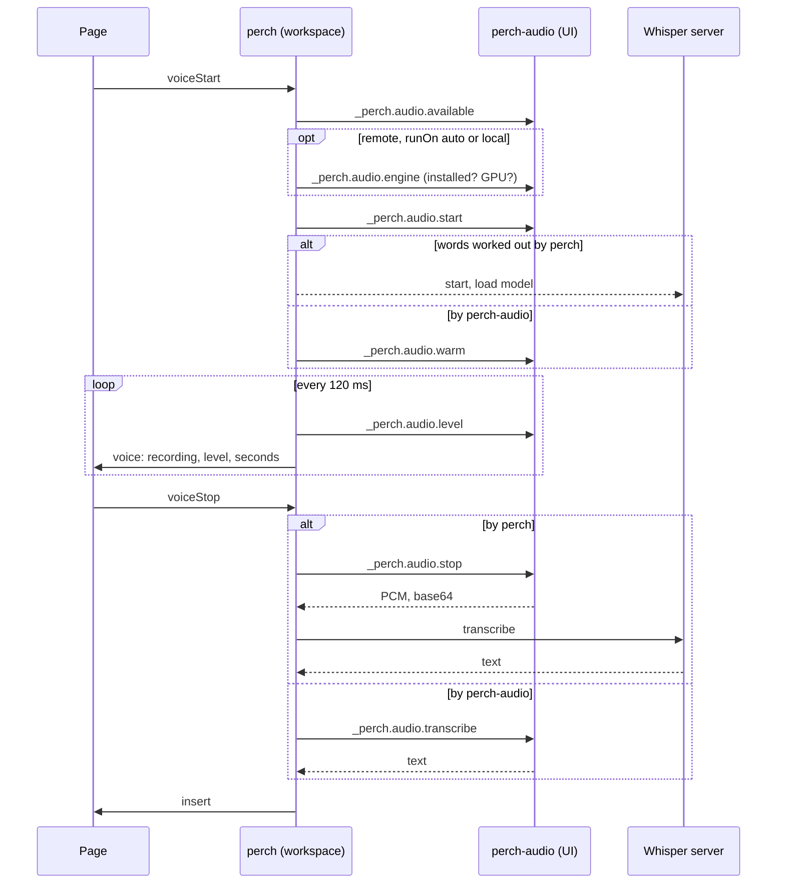

# 112 — Dictation

## The constraint that shapes it

perch runs with the workspace. Under Remote-SSH that is another machine,
and the microphone is not on it. A webview cannot open a microphone
either. So dictation is two extensions:

| Part | `extensionKind` | Runs on | Does |
| --- | --- | --- | --- |
| **perch-audio** | `ui` | the machine the user sits at | Records; transcribes when that machine is the one with the GPU |
| **perch** | `workspace` | the machine with the workspace | Transcribes otherwise; decides which |

OpenAI's Codex extension is built the same way, with a `codex-audio`
companion, for the same reason.

**Where the words are worked out** (`perch.voice.runOn`): both
extensions carry the same engine (`src/voice.js` and `voice/`, copied
into perch-audio by `make audio-engine`, so each package is whole). With
no remote they are one machine and perch's own engine is used. Under
Remote-SSH, `auto` asks perch-audio whether its machine has an NVIDIA
GPU (`nvidia-smi -L`, once) and, if so, has it transcribe: a desktop
with a GPU keeps its own audio, and a CPU-only container is spared the
work; only the text crosses. Otherwise the audio crosses and perch
transcribes, as before. `local` and `remote` force either. Each side
sets up its own environment, in the same place
(`~/.local/share/perch/voice`) so that on one machine the two share it.



The model starts loading when recording begins, so it is ready by the
time the user stops speaking.

## perch-audio

Internal commands, prefixed with an underscore:

| Command | Returns |
| --- | --- |
| `_perch.audio.available` | `{ ok, api, devices, states, device, busy }` |
| `_perch.audio.start` | `{ ok, id, device, sampleRate, maxSeconds }` |
| `_perch.audio.level(id)` | `{ level, seconds, ended, silent }` |
| `_perch.audio.stop(id)` | `{ pcm, sampleRate, seconds, silent, ended }` |
| `_perch.audio.cancel(id)` | `{ ok }` |
| `_perch.audio.engine(opts)` | `{ ok, installed, gpu, home, host }` (api 2) |
| `_perch.audio.setup(opts)` | `{ ok }` after the one-time setup there, with its progress shown there |
| `_perch.audio.warm(opts)` | `{ ok }`; loads the model |
| `_perch.audio.transcribe(id, { engine, language, prompt })` | `{ text, language, seconds, silent, ended }`: stops the recording and transcribes it there |
| `_perch.audio.unload()` | `{ ok }` |

`opts` are the engine settings (`model`, `device`, `python`, `idleMs`),
sent with each request so that perch-audio needs no settings of its own.
`api` is 2 with these; a perch-audio at 1 still records, and perch then
transcribes, whatever `runOn` says short of `local`.

Audio is 16 kHz, mono, 16-bit, carried as base64 because a command's
arguments and results must be JSON to cross between machines. That is
32 KB a second. Recording stops at `perchAudio.maxSeconds`, 180 by
default, about 8 MB encoded.

**Choosing a device.** Two traps, both found by testing on real
hardware:

1. **The system default cannot be trusted.** On Linux the first device
   listed is often a *monitor* source, which records what the speakers
   play. Devices named "Monitor of …" are passed over.
2. **An analog input exists whether or not anything is plugged in.**
   Recording an empty jack yields electrical noise. On Linux perch-audio
   asks the sound server, `pactl -f json list sources`, for each port's
   availability.

| Every port reports | State | Treated as |
| --- | --- | --- |
| at least one `available` | connected | preferred |
| all `not available` | unplugged | not a microphone |
| anything else, or no ports | unknown | usable |

USB and Bluetooth inputs have no jack to sense and report unknown, so
they are never ruled out. A device the user has chosen by name is used
whatever the system reports.

**Bluetooth headsets.** In the A2DP profile a headset has no source at
all, and PipeWire's own switch to the headset profile happens only for a
stream on the default source, not for a recorder that opens a device by
name. So perch-audio reads `pactl -f json list cards`, offers each
`bluez_card` that has a headset profile with a source under its
description (which is also the source's name once it exists), and
around a recording from it runs `set-card-profile` to the headset
profile (mSBC first, 16 kHz) and back to the previous one. It waits up
to four seconds for the microphone to be listed. Verified with Galaxy
Buds Live on 2026-09-30: the profile switch takes about a second and the
source appears as "Galaxy Buds Live (0310)".

## The engine

Everything lives under `~/.local/share/perch/voice`, never in the system
Python:

| Path | Holds | Size |
| --- | --- | --- |
| `venv/` | faster-whisper, CTranslate2, NVIDIA's cuBLAS and cuDNN wheels | about 2.6 GB |
| `models/` | the Whisper model | about 1.6 GB for `large-v3-turbo` |
| `installed.json` | what was installed, from which requirements | |

"Installed" means the environment exists, was built from the current
`requirements.txt`, and this model has been fetched. A changed
requirements file means a fresh install.

The environment is `python3 -m venv`. Debian and Ubuntu ship `python3`
without `ensurepip` until `python3-venv` is installed, and a container
often has no `sudo` to add it: `venv` then lays the environment out and
exits 1, and a second try finds a `python` with no `pip`. Setup takes
such an environment as it is (`--without-pip`), and brings pip in:
`ensurepip` if the interpreter has it, otherwise pip's own installer
fetched from `bootstrap.pypa.io`, run once and deleted. Only when both
fail does the user see a message, naming `python3-venv` and
`perch.voice.python`. Seen on a JupyterHub container (Ubuntu 22.04 image, no
`python3-venv`, no `sudo`) on 2026-09-30.

**The server** speaks JSON lines over stdin and stdout:

```
-> {"id": 1, "op": "transcribe", "pcm": "<base64>", "sample_rate": 16000, "language": null}
<- {"id": 1, "ok": true, "text": "...", "language": "en", "seconds": 3.2, "took_ms": 210}
```

| Behaviour | Reason |
| --- | --- |
| CUDA libraries are loaded by path at start | NVIDIA's wheels install them where the loader does not look |
| The model is run once on silence at load | A GPU that loads a model can still fail on first use |
| Falls back `cuda float16` to `cuda int8_float16` to `cpu int8` | Works without a GPU |
| `--model auto` is `large-v3-turbo` on a GPU and `small` on a CPU | Measured on a 30-core container: turbo's encoder is 4 s a pass on the CPU, `small` under 1 s |
| On a CPU, threads follow the cores allowed (affinity, cgroup quota; at most 16) | CTranslate2's default is 4 threads whatever the machine: 6.8 s a pass became 4.0 |
| On a CPU, greedy decoding; a beam of 5 on a GPU | The beam is most of the CPU wait for a few words |
| Voice-activity detection is on | A pause is not transcribed as words |
| Stops after ten idle minutes | Frees about 2.5 GB of GPU memory for other work |
| Asked to quit before being killed | It can exit cleanly |

**Setup** is asked for once, in a modal that names the machine it will
install on. That matters under Remote-SSH, where the install lands on
the remote.

## Alternatives considered

| Option | Verdict |
| --- | --- |
| Local Whisper | **Chosen.** Private, free, works in both kinds of tab |
| ChatGPT's own dictation | Rejected. It uploads to a private `/transcribe` endpoint on ChatGPT's backend with the user's login: undocumented, and unsanctioned for other tools |
| Codex's recorder commands | Rejected. Private and undocumented. The same open-source library is used directly |
| OpenAI transcription API | Not built. Needs a key, costs per minute, sends audio out |
| Codex realtime voice | Not applicable. A spoken conversation, not dictation, and only through the app-server protocol |
